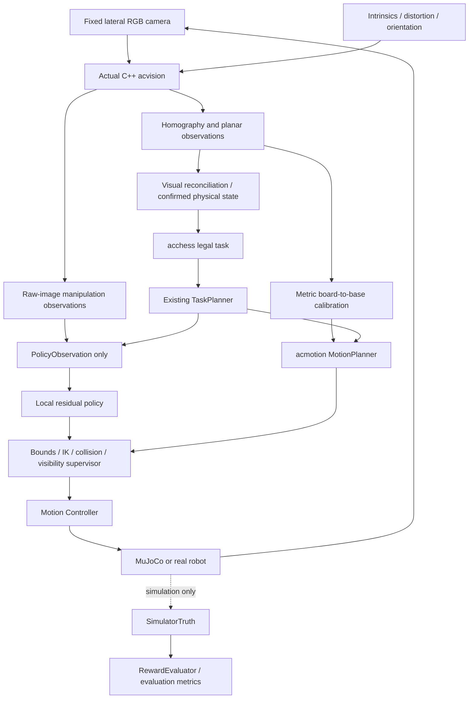

# Camera RL design and validation plan

Status: proposed Phase A design. Read [audit](phase-a-audit.md) and
[P031](../adrs/P031-camera-based-perception-and-sim-to-real-rl.md) first.
All contracts below are proposed, not existing functionality.

## Proposed data flow

## Frames and calibration contract

| Frame / mapping | Units / convention | Required evidence |
|---|---|---|
| Raw image | pixels, x right/y down, RGB at acquisition | camera ID, timestamp, width/height |
| Undistorted image | pixels; explicit intrinsics and distortion model | saved calibration ID, resolution, reprojection errors |
| Rectified image | initially 800×800 pixels, H maps undistorted plane to image | detected corners, validity, orientation |
| Canonical square | row 0 = rank 8, column 0 = file a | orientation reference; do not equate image TL with a8 |
| Board metric frame | mm, origin A1 center, x toward H1, y toward A8 | measured pitch/geometry; plane z=0 |
| Base frame | mm in acmotion; metres at simulator boundary | measured rigid transform and board height |
| Joint coordinates | C++ J1/J2/J3 rad, Z mm, gripper percent | calibrated signs/zeros/limits; explicit simulation mapping |
| TCP | pose relative to tool/base; mm/rad or explicit SI conversion | measured geometry or labeled experimental transform |

After orientation normalization, square `(r,c)` center is `(100(c+.5),100(r+.5))`
in the current 800-pixel rectangle. In uniform board coordinates its metric center
is `(c*s,(7-r)*s,0)` relative to A1, with measured pitch s. For a point on the
plane, apply H and homogeneous division before conversion. Use `T_base_board`
to map metric board points to base; convert mm to metres exactly once at the
MuJoCo boundary. Homography alone cannot recover scale or this base transform.

Raw-camera rays from raised objects do not identify their board-plane footprint.
Local gripper pose needs validated markers, calibrated projection with known
geometry, or temporal visual estimation. Command-derived FK may predict a pose
but must carry uncertainty; it cannot confirm actual grip or missed motor steps.
Graveyards require their own calibrated regions and visibility; do not crop them
out and then claim capture verification.

Camera candidate experiments retain one fixed pose per episode and record actual
render intrinsics/extrinsics. Assess all 64 cells, both graveyards and TCP visibility
at each trajectory phase. No physical mounting angle is selected without geometry
and occlusion evidence. Use raw and rectified images together for diagnosis.

## Perception and policy contracts

PerceptionFrame must include schema version, frame ID/timestamp, camera/calibration
IDs, image size/color format, calibration status, corners/H, canonical orientation,
and 64 square records. Each record has occupancy including UNKNOWN, optional color,
optional piece class/center, units/frame, and validity. Unimplemented confidence
or visibility is null/unknown, never 1.0/visible by default. Add explicit error
codes for missing board, ambiguous orientation, stale frame and invalid calibration.

Initial PolicyObservation candidate:

| Field | Source / frame / units | Availability and reliability |
|---|---|---|
| Source/target square | validated task, integer canonical indices | host information, not sensor data |
| Rectified crop | acvision warp, uint8 pixels | conditional on valid calibration |
| Raw local image | same camera, pixels | retains height-related appearance; no claimed 3D pose |
| Occupancy/color/unknown mask | acvision, canonical cells | must extend current enum for unknown |
| Piece planar center | future validated visual localization, board mm | currently unavailable; optional, never oracle-filled |
| Gripper visual location/error | future visual estimator, explicit frame | currently unavailable; no invented 3D vector |
| Calibration validity / frame age | calibration and acquisition | implement; reject stale or invalid frames |
| Previous action / commanded target | supervisor history, normalized/mm/rad | available as commands only |
| Controller phase/status | supervisor/protocol | available; DONE is not grasp evidence |

First compare structured-only features against hybrid crops plus validated features.
Current occupancy-only output cannot control a fine grasp. Implement localization
first or explicitly use the image candidate; never pretend cell center is measured
piece center. Start feedforward with previous command; add frame history or recurrence
only if temporal evaluation shows benefit. Visual verification itself must use a
time sequence, even if the policy remains feedforward.

Inference must expose `predict(PolicyObservation) -> ResidualAction`, outside the
environment object. Prefer a separate inference process for the strict boundary;
its transport accepts only the schema, not arbitrary serialized Python objects.
Training rollout storage may separately contain reward/done; those cannot become
actor inputs. Diagnostics and privileged critic extensions require separate ADRs.

## Proposed bounded action and supervision

Four candidate outputs: delta X/Y/Z in the calibrated local task frame and a
gripper aperture adjustment. Each normalized output is scaled by a versioned
per-phase bound and a cumulative envelope around the nominal planned trajectory.
Bounds remain disabled/unset until geometry and controller trials justify values;
the old .008/.002 increments are not hardware calibration. No independent yaw
action until J3/TCP parity is resolved.

Every candidate passes phase permissions, IK/joint limits, rate/acceleration limits,
collision checks over the proposed segment, and visual freshness checks. Reject
invalid candidates before execution. Calibration loss means hold/stop and recovery;
do not continue blindly or invent a clear retreat under occlusion. Physical state
commits require verified release/placement, not merely accepted action or DONE.

## Reward specification for future experiments

Keep reward extraction in RewardEvaluator(SimulatorTruth, task, action, events).
Proposed family, with coefficients configured and logged rather than claimed tuned:

`r = w_g*I_grasp + w_l*I_lift + w_t*I_transport + w_p*I_place + w_s*I_success`
`    - w_d*I_drop - w_b*I_bystander - w_c*I_forbidden_contact`
`    - w_u*||a||² - w_time*dt + gamma*Phi(next)-Phi(current)`

I terms are phase-transition events, paid once, not rewards accumulated by holding
a favorable state. Grasp/lift require sustained evidence; transport requires holding
through travel; placement includes release, stable upright position within the
configured target tolerance and retreat. Complete success requires both oracle
criteria (simulation evaluation) and independent visual verification. Record their
disagreement; oracle success never forces a visual success. Do not reward a piece
merely passing through the destination while still held. Define contact exclusions
for intended fingertip-piece and piece-board contact. Full-body collision penalties
remain unqualified until those colliders are restored and tested.

Optional potential Phi must use a bounded task-progress quantity; log whether it
uses oracle state. Report sparse success metrics alongside any shaped reward.
No coefficients or physical tolerances are asserted validated in this proposal.

## Randomization and partial observability

Version a configuration with seed, parameter, units, distribution, range, evidence
source and provisional/measured status. Separate training distributions from held-out
test distributions. Start at zero perturbation to validate parity. Then sweep camera
translation/rotation, board XY/yaw, intrinsic/distortion error, corner localization,
lighting/exposure/blur/noise, piece offsets, friction and actuator response.
Require measured ranges or explicitly labeled provisional experiments; do not ship
unexplained constants. Board assembly variation needs CAD/physical measurements.

Prefer errors produced by actual acvision on rendered images. Synthetic occluders
must be labeled test fixtures, not realistic human-hand models. Keep a fixed camera
within an episode; perturb its mounting between episodes. Record calibration age,
visibility and failure under arm occlusion. Never move camera lookat using target
truth. Establish multi-frame visual evidence for lift, release and final stability;
invisibility means unverified rather than empty or successfully grasped.

## Incremental roadmap and acceptance gates

1. **A — this increment:** source audit, contracts and P031 proposed. Review before
   replacing the training environment. No new training or checkpoint migration.
2. **B1 — executable reuse:** fresh C++ build; actual acvision image adapter;
   compare direct-library and adapter output on identical inputs; RGB/BGR tests;
   invalid schema/image/calibration tests. Update ADR before implementation.
3. **B2 — perception validation:** fix/measure corner extrapolation; explicit
   orientation/unknown semantics; render lateral views and overlays (raw corners,
   rectified grid, square labels, actual available detections). Validate 64 center
   mappings for rotations, camera/board perturbations and negative images. Use
   simulator projections only in the evaluator, never as detected corners.
4. **C — new environment:** separate inference/truth/reward boundaries, provenance
   validation, timestamps and loss-of-visibility handling. Tests inject forbidden
   fields and verify rejection; identical pixels/task/history with changed hidden
   simulator state must yield identical serialized policy inputs. Test that oracle
   reward/diagnostics/mirror buffers cannot reach predict. Preserve old v3 tests.
5. **D — conventional baseline:** calibrated CoordinateMapper to MotionPlanner,
   complete collision-checked trajectory, visual verification at grasp/lift/place/
   release, and confirmed-state transaction. Record failed and unverified trials.
6. **E — RL pilot:** only after B–D pass, train one pawn local correction task,
   freeze task/observation/action versions, seed and hashes. Benchmark persistent
   adapter versus bindings before scaling workers. No full chess curriculum yet.
7. **F — evaluation:** paired baseline/RL trials with held-out scenes, then new
   squares, lighting, occlusion and dynamics. Only after simple transfers succeed
   add captures, fixed home graveyard slots and full game integration.

Perception acceptance must report corner reprojection error, metric planar error
(mean/median/p95/max), all 64-square assignment accuracy, occupancy/color confusion,
unknown rate and orientation failures. Error budgets come from measured grasp
clearance, not arbitrary pixel accuracy. If those measurements are missing, the
motion-training gate stays closed even if unit tests pass.

Compare grasp, lift, stable released placement and full-transfer success; mean,
median and p95 placement error; duration; drops; bystander disturbance; failures
under occlusion/calibration error; inference/perception latency and throughput.
Use the same held-out scenarios for baseline and RL, record all denominators and
confidence intervals, and predeclare sample sizes from the intended precision.
Five seed trials are a smoke check, not deployment evidence. Do not claim improvement
from reward alone or from comparison against zero action.

## Blockers and migration

Missing now: calibrated physical board assembly and base transform, lateral camera
measurement, reliable occupied-board corner/orientation contract, visual gripper/
height estimates, unknown/confidence semantics, native image adapter, full-transfer
vision baseline, full collision validation and J3 simulation/hardware parity.

Do not reuse old checkpoints silently: different camera/observation/action schemas
require fresh policy heads and explicit compatibility experiments. Any encoder
transfer must be compared to scratch training. Keep legacy launcher/replay unchanged
and give the new environment and launcher distinct names. Record source SHA, model,
camera, calibration, perception library/config, task and randomization hashes per run.

For developers: begin B1 with an offline rendered-image fixture, build the smallest
acvision CLI target, verify exact direct/adapter parity, then add the lateral camera
dataset and overlays. Do not couple a costly PPO run to debugging corner detection.
