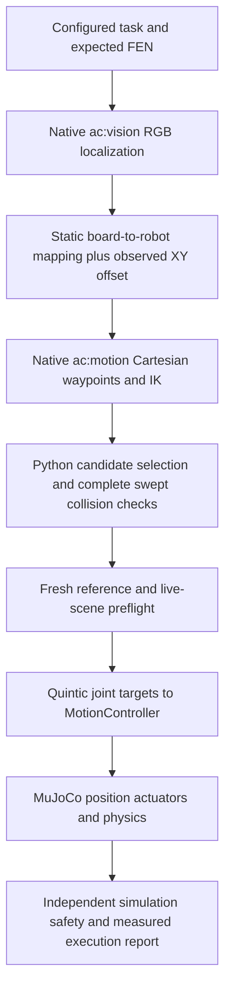

# M2 native approach qualification and command flow

Recorded on 2026-11-07. This increment follows the [M1 audit](hybrid-m1-audit.md)
and [ADR S029](../../simulation/docs/adrs/S029-native-approach-qualification.md).
It qualifies a particular simulated approach and retreat. It does not qualify
the full local manipulation workspace, grasp/lift, transport with a held piece,
Chess Core end-to-end execution or physical hardware.

## What actually runs

The dedicated [qualification example](../../simulation/mujoco/examples/qualify_hybrid_approach/README.md)
loads a prepared environment JSON. In this experiment, that file supplies the
task `white_pawn_e2`, source `e2`, the expected initial FEN and the existing
32-piece wrist-aware bundle. It is not a live Chess Core API request.



The model-based supervisor can inspect simulator state; camera localization
generates object endpoint estimates. There is no learned policy in this test.
Nothing from this example is sent to the physical robot.

## What ac:motion sends

The C++ `MotionPlanner::planTransfer` returns eight Cartesian `Pose` records:

| Phase | Position | Gripper intent |
|---|---|---|
| APPROACH_SOURCE | source XY, safe Z | open |
| LOWER_TO_SOURCE | source XY, pick Z | open |
| GRASP_PIECE | source XY, pick Z | closed |
| LIFT_PIECE | source XY, safe Z | closed |
| APPROACH_TARGET | target XY, safe Z | closed |
| LOWER_TO_TARGET | target XY, pick Z | closed |
| RELEASE_PIECE | target XY, pick Z | open |
| RETRACT | target XY, safe Z | open |

These are desired poses, not motor pulses, a continuous collision-free path,
or proof that a piece moved. `planTask` delegates physical move/removal tasks
to this generator. The current qualification calls the native `acmotion_plan`
bridge directly and uses only its high-clearance positions. It keeps the
fingers open and does not execute the eight manipulation phases.

The C ABI planner returns an 8×4 array: XYZ in millimetres and gripper intent.
`NativeMotion.plan` converts XYZ to metres for Python. `NativeMotion.solve`
calls the native IK using static robot geometry; for the wrist model, the
adapter recalculates effective elbow-to-TCP geometry for each requested wrist
angle and appends that bounded wrist command to the five native outputs.

The actual simulation joint order is:

```text
[base angle rad, vertical Z m, elbow angle rad,
 finger 1 travel m, finger 2 travel m, wrist angle rad]
```

Both finger targets must be equal. There are six actuator commands but the
two coupled fingers represent one gripper opening degree of freedom. They
must not be confused with six independent robot axes.

For the accepted seed-7 approach, the endpoint was approximately:

```text
[0.263776682, 0.082939632, -1.087083507, 0, 0, 0]
TCP = [0.262850000, -0.086800000, 0.099939632] metres
```

These numbers belong to this experimental bundle and reference frame. They
are not ready-to-send hardware targets. Zero finger travel means the model's
open position; zero wrist means its experimental lower limit.

## Where alternative routes and collision checking happen

The current native C++ waypoint generator has no obstacle search. The new
Python motion-intelligence adapter considers different model-derived heights,
wrist angles and elbow branches. It tests direct joint travel and, when IK
permits, staged travel through the planner's high-clearance waypoint.

Every accepted complete approach and retreat passes the existing SweptChecker.
The candidate scene uses static piece geometry at RGB-estimated XY positions.
A separate pre-execution check uses the actual simulated scene, for independent
safety. A plan is invalidated by changed geometry/dynamics, starting state,
command mapping, fresh visual localization or board reference. The model's
full-gripper hulls remain checked; collision checking is not disabled to pass.

This is a bounded candidate family. Exhausting it does not prove no route exists.
The certified entry box is a small collision-free neighborhood, not a validated
volume in which arbitrary grasp and lift actions can be attempted.

## Why execution timing changed

The first dynamic attempt used a linear joint ramp at manifest velocity. It
stopped after 4 ms: a finger briefly exceeded its limit by 0.1174 mm during
arm acceleration, above the existing 0.05 mm numerical excursion threshold.
The commanded path alone had passed preflight, demonstrating why dynamics
and measured execution must also be tested.

The correction retains that geometric path and uses
`s(u)=10u^3-15u^4+6u^5`, which starts and ends at rest with zero acceleration.
Duration includes its peak derivative of 1.875 and an explicit velocity fraction
of 0.25. Limits, collider shapes and collision clearance remain unchanged.
This setting is experimental; hardware acceleration/torque calibration is pending.

## Measured evidence and reproducibility

The preserved initial failed attempt is
`simulation/mujoco/examples/qualify_hybrid_approach/runs/559d760568054152b5cfff4a71a6827d`.
The first successful watched approach/retreat is
`simulation/mujoco/examples/qualify_hybrid_approach/runs/195d5566c3404701b51c98a7050c15a4`.
A fresh seed-7 repetition with source/library/configuration provenance is
`simulation/mujoco/examples/qualify_hybrid_approach/runs/e24d597ad03d457fa05e98ff5dae3c79`.

Both successful trials completed approach and retreat in 8.8 seconds of
simulated execution. The repetition's planning took 33.01 seconds; these are
different measurements. Measured arrival TCP error against the commanded
model endpoint was 0.002619 mm. Maximum final piece displacement was
0.000661 mm, consistent with tiny simulation settling drift. No runtime
contact/toppling/displacement/limit guard fired. These are model-relative
diagnostics, not physical accuracy estimates or an independent success rate.

The fresh repetition includes actual RGB images before motion, at verified
arrival and after retreat. Its provenance lists Python-source hashes, the
native-library hashes, configuration hash, seed and MuJoCo version. The plan
contains rejected candidates and conservative sweep sample counts. Run paths
are local experimental artifacts, not a promise that ignored result directories
are included in a source checkout.

Focused regression command:

```powershell
$py = '.\simulation\mujoco\.venv\Scripts\python.exe'
& $py -B -m pytest simulation/mujoco/tests/test_hybrid_approach.py simulation/mujoco/tests/test_approach_sweep.py simulation/mujoco/tests/test_board_piece_localization.py simulation/mujoco/tests/test_autonomous_manipulation.py simulation/mujoco/tests/test_collision.py simulation/mujoco/tests/test_backend.py simulation/mujoco/tests/test_native_runtime.py -q
```

Result after adding fresh-reference and trajectory-continuity rejection coverage:
**45 passed, 9 skipped**, 19.17 seconds. Skipped tests are not counted as
passing native integration checks. The runnable repetition separately exercised
the configured native DLLs and actual dynamic execution. The M1 capture failure
remains an open baseline issue; this approach-only increment does not fix it.

A separate rerun of `test_task_plan.py` produced **3 passed, 1 failed** in
8.06 seconds. The same previously recorded
`test_physical_capture_removes_before_attacker` failed with
`GRIP_LOST_DURING_TRANSPORTING`. The regression suite is therefore not fully
green, and complete manipulation remains gated.

## How the physical robot should use the same architecture

For an intended `MOVE(e2,e4)`, Chess Core supplies legal chess/physical tasks;
captures require removal before the attacker transfer. Vision and the confirmed
physical-board state resolve the source object and its visual location. An
ArUco board reference supplies image-to-board mapping. A separately calibrated
board-to-robot transformation is still required: homography alone does not
tell motors where the board lies in robot coordinates.

The planner owns global approach. After verified arrival, an explicitly bounded
local policy should own fine XY/Z, wrist and finger adjustments for grasp/lift.
The supervisor validates each proposal. After visual lift verification, the
planner should regain ownership for held-object transport, placement and retreat.
This handoff is the next milestone; it is not implemented in this example.

The repository already defines `JointTarget`/`JointSegment` and the ACM1 codec
with J1/J2/J3 angles in radians, Z in millimetres, gripper percent and duration
in milliseconds. `MotionExecution` sends segments and expects matching ACK/DONE
events through `IMotionTransport`. The simulator's six-value actuator vector
cannot simply be serialized as those fields: map base/elbow/wrist signs, zeros,
Z units and the two coupled-finger targets to the hardware's single opening
command using measured calibration. Firmware must convert joint targets to
the appropriate motor steps and servo commands.

There is no hardware actuation in the qualification example. Its MotionController
uses MuJoCo position actuators and simulated bias-force compensation; those
force values are not hardware measurements. A physical adapter needs verified
homing, measured limits, steps-per-unit, wrist switch handling, speed/acceleration
settings, gripper linkage and an emergency-stop strategy before deployment.

With only a camera, commanded steps are an estimate of arm configuration.
ACK means accepted and DONE means firmware reports completion, not proof of
actual position, grip or lift. Visual checks must detect the relevant outcome
and stop/reconcile when confidence is inadequate. Planar homography can locate
piece XY but does not, by itself, establish grasp height or that the piece is
held; this remains an observability and perception validation requirement.

## Remaining gates before local RL and complete transfers

- Define/test planner-policy handoff and a useful bounded local manipulation
  envelope, distinct from the small entry-neighborhood certificate.
- Validate local action supervision, perception loss and ownership transitions.
- Establish a repeatable deterministic grasp/lift baseline, including failures.
- Validate the carried piece's collision geometry during transport and release.
- Connect and evaluate the local learned policy with actor/simulator separation.
- Validate camera-only outcome verification and hardware-specific execution.

All current reports intentionally keep `training_eligible=false`. Opening Watch
does not mean PPO is updating weights. Existing autonomous and residual training
experiments are separate contracts; they are not silently resumed as this hybrid
controller.
