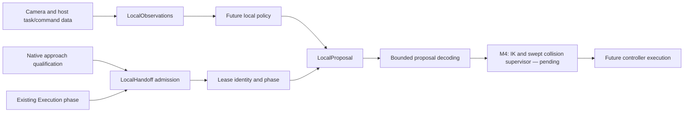

# M3 — Planner-to-local-policy interface

Implemented on 2026-11-07 following
[S030](../../simulation/docs/adrs/S030-planner-local-policy-contract.md).
The implementation is
[`hybrid_contract.py`](../../simulation/mujoco/src/atom_mujoco/hybrid_contract.py).
This increment adds an independently tested interface. It does not execute
actions, create a PPO policy, train weights or qualify new manipulation skills.

## Existing components reused

- `MoveTask`: task identity, internal piece identity, board squares, revision
  and timeout. External square-to-square task resolution remains upstream.
- `Execution` and `Evidence`: existing global phases, evidence ordering,
  freshness, board revision and durable task ledger. No second global task
  state machine is introduced.
- `VisualHistory`: the existing two-frame RGB and issued-command history
  preprocessing. The new builder validates inputs and freezes detached outputs.

## Data and ownership flow



The default owner for local phases is the supervisor. Local control requires
an admitted lease. During existing `GRASPING` and `LIFTING` phases an active
lease makes the policy the owner; during `VERIFYING_GRASP` the supervisor owns
control. `TRANSPORTING` returns ownership to the planner. The lease never
advances the existing global phase or updates confirmed physical occupancy.

The existing `Execution.advance` still requires its normal evidence gates.
Controller acknowledgement alone cannot advance through grasp/lift verification.
An `Execution` configured with `allow_oracle=True` cannot acquire this camera-only
lease. This flag check does not prove the truth of arbitrary adapter evidence.
Actual camera-only grasp/lift verification remains to be implemented and tested.

## Admission requirements and the M2 boundary

`ApproachAdmission` binds the existing task and board revision to model,
camera/reference and workspace-evidence identities. It also requires a fresh
timestamp, actual completed approach, no subsequent retreat, an explicitly
qualified local workspace and training eligibility.

The [M2 report](hybrid-m2-qualification.md) intentionally records
`local_manipulation_workspace_qualified=false` and `training_eligible=false`.
Its small collision-free entry box is not an entire grasp/lift envelope.
The tested run also retreated to park. It cannot authorize this local policy.
No code changes those flags to make admission pass.

Admission fields are assertions to be generated by future qualification
adapters. An evidence ID is provenance, not a mathematical certificate or
authentication mechanism. M3 validates interface consistency; it does not
establish that arbitrary caller-supplied qualification assertions are true.

## Policy observations, schema 1

Only the following arrays are returned to the actor. No plan/report/model,
simulation object, measured joint positions, body poses, contact or reward
objects are accepted by the observation builder.

| Key | Shape / dtype | Source |
|---|---|---|
| `image` | 6×96×96, uint8 | Two rectified RGB images, resized using VisualHistory |
| `task` | 4, float32 | Source and target file/rank indices normalized by 7 |
| `commanded_joints` | 6, float32 | Issued targets normalized using static limits |
| `command_history` | 12, float32 | Two issued-target samples |
| `previous_action` | 5, float32 | Previous bounded local proposal |
| `perception_valid` | 1, float32 | Validated camera/reference input |
| `visual_source_xy_m` | 2, float32 | Camera-derived source XY in the calibrated task frame |
| `object_context` | 8, float32 | Logical six-kind and two-color one-hot context |
| `phase` | 2, float32 | GRASPING or LIFTING one-hot label supplied by the host |

The phase label in an observation does not itself grant ownership. LocalHandoff
checks ownership separately against the existing global execution.

Camera validation requires a finite fresh timestamp, strictly increasing
sequence, matching camera/reference IDs, oriented nonsingular homography and
uint8 RGB. Invalid input does not advance image/command history. Output arrays
have immutable byte backing, and the returned mapping cannot gain extra keys.
Normalization does not turn commanded joints into measured proprioception.

The current source XY input must come from ac:vision and the calibrated
board-to-robot mapping. The builder does not discover the origin of an arbitrary
numeric pair; wiring and integration tests must enforce that provenance in M4
and later training. No z-coordinate of the selected piece is exposed here.

The observation invariance test holds allowed camera/task/command values fixed,
changes the actual hidden MuJoCo qpos/qvel and extra privileged metadata, and
checks every actor array remains identical. This tests the new boundary; it is
not a claim that every historical training environment has this schema.

## Five local action controls

```text
[delta TCP X, delta TCP Y, delta TCP Z, delta wrist, delta finger travel]
```

Each control is finite and normalized to [-1, 1]. For each component:

```text
candidate endpoint = commanded start + action × static rate × control interval
```

TCP values use the calibrated task frame expected by native IK. XYZ units are
metres, wrist units radians and opening units metres of coupled finger travel.
Negative finger travel closes the current model; this is not a hardware servo
percentage. Both simulated finger targets must agree.

The interval and rates are host data, not policy outputs. They must be derived
from the selected robot/controller and a separately validated local workspace;
M3 supplies no invented physical default envelope. The example numeric limits
in unit tests are explicitly synthetic fixtures and must not be used on hardware.

There is no elbow-branch toggle, variable-duration control, global destination
or direct arbitrary joint command. Bounds violations are rejected, with no
silent clipping or projection. `PROPOSED / REQUIRES_IK_AND_SWEPT_CHECK` means
only that a local endpoint is within the declared numeric envelope. It is
neither actuator acceptance nor evidence of a collision-free trajectory.

## Lease/proposal rejection and recovery boundary

Every LocalProposal contains task ID, lease ID, strictly increasing proposal
sequence and matching local phase. Caller-owned action arrays are detached
into immutable tuples. Replayed or context-mismatched proposals are rejected.
Changed camera/reference identity, backward/nonfinite clock and task timeout
revoke local ownership. After revocation, a proposal cannot command anything.

This module performs no stopping of motors because it never executes commands.
The M4 supervisor must connect these outcomes to actual hold/stop/reconciliation,
fresh perception at execution, native IK, complete local sweeps and feedback.
It must also bind declared envelope/rates/model identities to qualification
artifacts rather than trusting a constructed dataclass as safety proof.

## Tests and reproduction

Run PowerShell from the repository root:

```powershell
$py = '.\simulation\mujoco\.venv\Scripts\python.exe'
& $py -B -m pytest simulation/mujoco/tests/test_hybrid_contract.py simulation/mujoco/tests/test_supervision.py simulation/mujoco/tests/test_hybrid_approach.py simulation/mujoco/tests/test_autonomous_manipulation.py -q
```

The tests cover allowed observation equality despite changed hidden physics,
immutability, invalid/stale/replayed camera input, action dimensions/numerics,
local bounds, unqualified/retreated approach rejection, task/reference identity,
oracle-enabled rejection, global phase ownership, proposal replay and timeouts.
They use synthetic admission assertions to test interface behavior; they do
not demonstrate an actual qualified grasp workspace.

The final focused run produced **56 passed, 2 skipped** in 5.09 seconds.
[Machine-readable evidence](evidence-hybrid-m3/summary.json) records the test
command, explicit non-training/non-execution status and source/test/ADR hashes.
Skipped cases are not counted as passed native integration tests.

This is a contract test increment, so there is no new training command or Watch
window to present as a learned-policy run. Use the existing native approach
example for the independently qualified motion visualization. No old checkpoints
were overwritten or silently resumed. The five-action schema and observation
keys are incompatible with seven-action autonomous or older residual policies.
Any later partial transfer of CNN weights needs an explicit migration and test.

## Remaining milestone sequence

1. M4: connect this contract to the native IK/swept supervisor and execution,
   including a justified local envelope, fresh perception and rejection feedback.
2. M5: demonstrate repeatable deterministic grasp/lift under the same conditions.
3. M6: train/evaluate a local policy against that baseline with separated
   simulator reward and camera-only actor data.
4. Subsequent milestones: visually verified handoff to held-object transport,
   placement, multi-object evaluation and Playground integration.

The pre-existing capture regression `GRIP_LOST_DURING_TRANSPORTING` remains open.
Approach success and passing interface tests are not complete transfer success.
