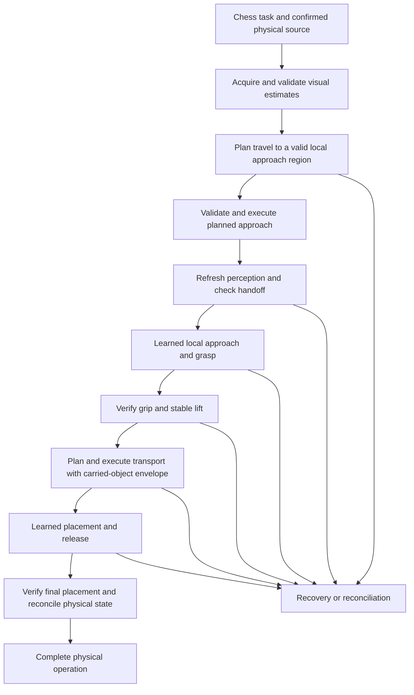

# Planned motion and learned local manipulation in ATOM

Status on 2026-11-07. This document records the recommended next architecture
and its acceptance gates. The complete planner-to-policy supervisor is
pending implementation. Existing residual and autonomous runners provide
experimental baselines. [Decision S027](../../simulation/docs/adrs/S027-planned-motion-local-learning.md)

## Why this direction

The watched autonomous experiment recorded five approach successes in 24
training episodes and two in four final evaluation episodes. Its criterion
was a mean fingertip clearance of 35 mm. It recorded zero bilateral grips
and zero lifts. Two held-out configurations ended farther from the object.
These results motivate reducing the scope of the first practical learning
task. They do not establish statistical superiority of another architecture.
[Measured results](autonomous-reach-results.md)

The proposed division lets the motion system handle travel through the
workspace and lets learning concentrate on interaction near the selected
piece. This is an engineering hypothesis for ATOM. Compare it against the
preserved autonomous baseline on the same geometry, conditions and criteria.

## Responsibilities

| Component | Responsibility | Required output |
| --- | --- | --- |
| Chess Core | Rules, legal moves and chess-specific task expansion | Logical task and expected board context |
| AC:Vision | Camera acquisition, reference detection, planar localization and visual evidence | Timestamped estimates, validity, uncertainty and calibration identity |
| Motion Intelligence | Physical task sequencing, planning requests, local policy inference and supervision | One active command owner and verified stage transitions |
| AC:Motion | IK, geometry mapping, planned motion and execution contracts | Candidate trajectories with limits, provenance and collision evidence |
| Local RL policy | Contact approach, wrist/finger choices, grasp and lift behavior within a declared region | Bounded proposals, including alternatives after rejection |
| Motion Controller | Actuator commands, timing and cancellation | Execution acknowledgments and faults |
| MuJoCo | Simulated dynamics, contacts and independent physical evaluation | Training reward and diagnostic evidence isolated from actor inputs |

The planner and learned policy participate in the same physical operation.
The supervisor owns the transition between them. A controller acknowledgment
only confirms its command contract. Logical occupancy and confirmed physical
occupancy have separate owners and update rules.

## Example operation

For a legal E2-to-E4 task, obtain a current visual board reference and reconcile
the source occupant. Resolve its internal physical identity from confirmed
physical state. The caller supplies squares. Chess-specific capture or
castling expansion stays upstream of physical manipulation.

For a capture, the physical task sequence removes the captured piece to its
assigned graveyard location before placing the attacker on the destination.
The graveyard remains part of obstacle geometry, occupancy and reconciliation.
This sequence needs independent full-operation qualification after local
manipulation works.

## Handoff and command ownership

| Transition | Evidence required before proceeding |
| --- | --- |
| Vision to planner | Valid board orientation, calibrated metric mapping, source estimate, expected occupant and sufficiently current obstacle estimates |
| Planner to controller | Valid endpoints and joint limits, a complete accepted swept trajectory, matching scene/calibration revision |
| Planned approach to local policy | Planned execution ended, robot estimate is within the tested handoff region, fresh images and source evidence are available |
| Local policy to transport | Independently confirmed hold/lift and an updated carried-object collision envelope |
| Transport to local placement | Accepted arrival, current destination evidence and a valid held-piece estimate |
| Placement to completion | Release, stable correct occupancy, acceptable neighbor disturbance and reconciled physical state |

Use one command owner at a time. Each command carries operation ID,
sequence, active stage and scene/calibration identity. Cancel or complete
the old execution before transferring ownership. A policy proposal goes
through the supervisor and existing controller. Every retry gets a recorded
outcome. Updating a source/destination because a command was sent violates
the physical-state contract.

A rejected path before movement permits another proposal while the confirmed
scene remains valid. Partial execution, unknown grip or changed occupancy
requires reconciliation before a newly planned move. Recovery behaviors need
their own verified trajectories and visual evidence.

## What the policy learns

The local policy should retain enough freedom to choose entry direction,
XY offset, height, wrist orientation, opening, closing timing and lift motion
inside its qualified region. Its action range and duration need physical
units, calibration provenance and actual trajectory-diversity measurements.
The local task goal and safe operating envelope define the experiment.

The old residual implementation constrains changes around nominal waypoints.
The existing free temporal implementation gives the policy wider control.
The proposed local learner must be evaluated explicitly against both.
Simply shrinking action corrections around a blocked nominal descent retains
the original feasibility problem. The old full-board search rejected every
tested candidate in its finite family. Valid approach regions and complete
paths must be demonstrated before planner-assisted training.

## Camera-only deployment boundary

Actor inputs may include current RGB/history, AC:Vision estimates, task
endpoints, expected kind/color from Chess Core, previous actions and commanded
joint history. Command-based FK is a host estimate. Actual joint positions,
object poses, contacts and hidden simulator state stay outside the actor.
Simulator measurements can supervise reward and independent evaluation.

ArUco homography establishes a board-plane reference. A metric board-to-base
transform, camera calibration and TCP geometry are additionally required.
Planar mapping alone supplies no measured object height or wrist pose.
Source identity from FEN expresses the expected occupant and must be reconciled
with physical evidence. Occlusion can make a grip or object pose unknown.

The current training uses cached synthetic reference images for localization.
Real deployment needs measured calibration and a documented reference-image
acquisition procedure. A moving board changes the board-to-robot relation,
invalidating paths tied to the previous transform. Reobserve and replan before
execution when that reference changes.

The physical arm has camera feedback and a reported wrist homing switch.
Commands provide an estimate of motion, with uncertainty from missed steps,
mechanical play and contact. The real system needs a tested visual grip/lift
verification method, or an explicit unknown result when evidence is insufficient.
MuJoCo bilateral-contact feedback has no direct camera-only hardware equivalent.

## Existing code and remaining work

| Area | Existing entry points | Remaining qualification |
| --- | --- | --- |
| Chess task expansion | `Software/integration`, `chess_commands.py`, `task_plan.py` | End-to-end learned physical execution and reconciliation |
| Native perception | `native_vision.py`, `board_piece_localization.py` | Local manipulation tracking, occlusion and hardware calibration |
| IK and motion | `Software/acmotion`, `native_motion.py` | Feasible region generation and complete paths into/out of the handoff region |
| Collision supervision | `collision.py`, `autonomous_control.py` | Shared observed-scene contract for planner and policy, calibrated gripper/obstacles |
| Local learning baseline | `camera_only_env.py`, autonomous environment/policy | A planner-initialized local training/evaluation contract with sufficient approach freedom |
| Execution and feedback | `motion_controller.py`, contact/scene feedback | Hardware-equivalent evidence and safe recovery |
| Watch and metrics | autonomous launcher and PPO dashboard | Clear planner/policy ownership, transitions and separated stage outcomes |

Robot/gripper contact geometry, material parameters and servo linkage remain
experimental. Initializing a simulated arm at a valid random pose proves that
pose's local admission, while reaching it from park requires a complete path.
The current randomized curriculum performs initialization teleportation.

The autonomous supervisor also stops after non-target contact or displacement
beyond its strict scene threshold. Earlier operator intent requested penalties
for non-toppling disturbances. Resolve that safety contract explicitly before
crowded-scene learning. Collision penalties, predicted prohibitions and emergency
stops have distinct meanings and must be reflected in tests and logs.

## Implementation sequence and experiments

1. Freeze geometry, camera and state/action versions. Reproduce the archived
   failures and preserve a deterministic conventional baseline.
2. Generate candidate approach regions from observed scene and calibrated
   geometry. Validate paths from park for different source squares, wrist
   orientations and elbow branches. Record failure categories and clearance scope.
3. Implement one supervisor and handoff schema shared by simulated and future
   hardware backends. Test rejection, cancellation, partial execution and stale
   scene versions before learning.
4. Prepare local episodes from demonstrated planner arrivals. First qualify
   a single-piece grasp, then stable lift. Keep approach and physical grip/lift
   rates separate and retain disjoint evaluation seeds.
5. Add nearby pieces, full-board positions and piece kinds progressively.
   Penalize contact/displacement according to the declared contract and stop
   on toppling or unsafe uncertainty. Test retention with one conditioned policy.
6. Qualify planned transport while holding the piece, local placement, release
   and final reconciliation. Then add capture/graveyard sequences.
7. Run matched comparisons between deterministic execution, old residual
   control, free temporal learning and planner-assisted local learning.

Record simulation time, decisions, wall time, optimizer updates, seeds,
planner CPU time and policy CPU/GPU time. Longer planned actions must account
for elapsed duration when defining reward and discounting. Reusing planner
trajectories depends on the algorithm's data assumptions. Keep PPO on-policy
and benchmark replay-based alternatives as separately versioned experiments.

Longer training requires repeatable feasible handoffs, finite updates,
verified checkpoint recovery and measured held-out skill acquisition. Set the
required count and success threshold before a final evaluation. A completed
runner, a larger return or an active neural-network display cannot satisfy
the physical manipulation gate on its own.

## Reading and evidence

The [MoPA-RL reading guide](mopa-rl-reading-guide.md) separates the paper's
mechanism from ATOM's proposed supervision. The [platform audit](autonomous-multi-object-audit.md)
lists actual assets, modules, checkpoints and physical limitations. The
[reach evidence](autonomous-reach-results.md) records the pilot outcomes and
numerical corrections. Current runnable experiments remain documented in the
[autonomous training README](../../simulation/mujoco/training/autonomous-manipulation/README.md).
