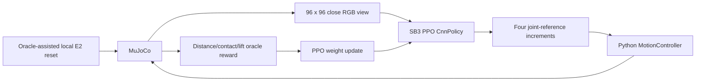

# Camera-based RL redesign — Phase A audit

Audited 2026-11-05 against `bd435cf3689d284afcc5fab7689359f93f188aa7`, branch
`ros2_simulation`. This is a source audit and architecture proposal, not evidence
that camera-guided manipulation or hardware deployment works.

## Repository evidence and preservation

`git fetch origin` completed. At audit time HEAD was 32 commits ahead and zero
behind `origin/ros2_simulation`. Recent work includes pixel PPO, encoder transfer,
parallel workers and the arena CAD transform fix. No merge, reset or push performed.

Pre-existing modifications: `simulation/mujoco/src/atom_mujoco/chess_commands.py`
and `playground.py`. Untracked: P022 live-monitor ADR, `module_monitor.py`,
`docs/reinforcement-learning/`, `hardware/Project/chess_board/`,
`hardware/Project/chess_pieces/`, `simulation/jsons/`, `simulation/learning/`.
These belong to earlier work and are excluded from this documentation increment.
All checkpoints, experiment data, meshes and CAD remain preserved.

## Current data flow

acvision, acchess and the C++ MotionPlanner are **not in this learning loop**.

## RL implementation

Sources: `simulation/mujoco/src/atom_mujoco/visual_grasp_env.py`, `backend.py`,
`motion_controller.py`; `examples/train_visual_grasp.py`, `replay_visual_grasp.py`;
`scripts/Start-RLTraining.ps1` and `tests/test_visual_grasp_env.py`.

- Algorithm: Stable-Baselines3 PPO, installed version 2.9.2; default CnnPolicy,
  no custom encoder or recurrent model configured. Actor/value networks are
  supplied by SB3, not acvision. Default image normalization applies.
  Installed NatureCNN uses 32 filters (8×8/stride 4), 64 (4×4/stride 2),
  64 (3×3/stride 1), ReLU and a 512-feature projection, followed by policy/value
  outputs. Continuous actions use the standard Gaussian policy distribution.
- Explicit settings: learning rate 0.0003; 128 rollout steps per worker;
  minibatch 32; four optimization epochs; seed 7 by default; PyTorch two threads.
  Installed constructor defaults: gamma .99, GAE lambda .95, clip .2,
  entropy coefficient 0, value coefficient .5, max gradient norm .5.
- Observations: uint8 RGB, CHW `(3,96,96)`, values 0–255. One image, no task
  coordinates, temporal stack, joint vector or detected occupancy.
- Actions: four finite normalized values in [-1,1]. Per step they increment
  J1 by .008 rad, Z by .002 m, J2 by .008 rad and both finger slides by .001 m
  times the action. Targets accumulate, clip to bundle joint limits, and pass
  through Python MotionController; no C++ trajectory or swept preflight per action.
- Default bundle: `runs/playground-fingertip-only-v1`, interactive-gravity-v3.
  Model hash recorded by current run: `2b439e465a9f048ed49df4d681a965650a5a1347f728c2b04cba9c4a935b6b59`.
  The bundle declares physical_calibration=false and an unreconstructed servo linkage.
  The five simulated actuators are J1, Z, J2, finger1, finger2; this does not
  represent the hardware's independent J3 yaw axis.
- Physics: .002 s step, ten substeps/controller interval (.020 s, 50 Hz).
  Five intervals/action give .100 s (10 Hz policy). Default horizon 100 actions.
  Gravity is (0,0,-9.81) m/s². Masses, inertias, gains and contact properties
  are experimental. Fingertip-only collision cannot establish full-robot safety.
- Controller rate-limits references using manifest speeds; compensates simulated
  gravity through `qfrc_bias / actuator_gain`. That feedforward accesses simulator
  dynamics and must not be mistaken for an implemented hardware controller.
- Joint limits in this bundle: J1 [-2,2] rad, Z [-.1,.2] m, J2 [-2,4] rad,
  fingers [-.021,0] m. These are simulation constraints, not measured hardware limits.

### Reset, camera and termination

Reset settles the scene, reads the true E2 pawn position and stem geometry,
solves Python IK, writes arm qpos and zero velocity, then settles again.
Arm perturbations are ±.003 rad, ±.0005 m, ±.003 rad.
`lift` performs a scripted contact-confirmed grip. `grasp` starts fully open,
20 mm above the oracle-derived grasp point. Reset rejects unexpected contact
or more than 8 mm bystander displacement.

The RL camera has distance .35 m, azimuth 90°, elevation -60°, and initially
looks at the actual pawn origin plus 25 mm Z. Its lookat remains fixed thereafter.
This is a local experiment view, not a validated physical camera calibration.
The separate `virtual_camera.py` is 640×480, distance 1.05 m, elevation -90°,
centered on the scene board; it is top-down and not the PPO observation camera.

Success requires bilateral contacts and lift >35 mm for three consecutive actions.
Termination is success, >8 mm bystander displacement or pawn world Z <0.
Horizon exhaustion truncates. No transport, placement, release or visual success
verification exists in this environment.

### Mandatory observation provenance table

The first row is the only current policy observation. Remaining rows identify
other values present in the environment, diagnostics or proposed future inputs.

| Current observation/value | Source | Available on real robot? | Allowed as policy input? |
|---|---|---|---|
| 96×96 RGB image | MuJoCo renderer | Camera images yes; distribution/calibration parity unproven | Yes, with validated acquisition |
| Exact pawn/world pose, origin and stem geometry | MuJoCo body/geom arrays during reset/reward | No exact pose sensing | No |
| Exact gripper position / target-relative distance | `site_xpos` and `xpos` | Not implemented visually | No |
| Actual joint position/velocity and force | `qpos`, `qvel`, actuator arrays | No measured equivalents established | No |
| Held/bilateral contact, pad contact | Simulation contact feedback | No tactile sensors established | No |
| Lift and bystander displacement | Difference of true body positions | Only future visual estimates, not this measurement | No |
| Attachment/velocity/hidden body state | Simulator internals, where available | No | No |
| `mirror_qpos` | Optional worker info for display | No | Display only |
| Previous action and requested reference | Host command history | Yes, as commands | Proposed, explicitly not measured pose |
| DONE/ACK/controller phase | Firmware protocol and supervisor | Interface exists; installed hardware unverified | Proposed with status semantics |
| Occupancy, rectified image | Actual acvision processing | Algorithm exists; not in RL | Proposed after validation |
| Gripper visual pose, confidence, occlusion | Not provided by current acvision | Unknown/unimplemented | Not until implemented and validated |

No direct numerical ground-truth observation leakage was found in current
`observation()` or `policy.predict(obs)`. However reset, camera initialization,
reward, contact supervision and gravity compensation use privileged state.
The environment exposes `sim` publicly; there is no structural inference boundary.
Oracle fields in `info` are used by logging/display, not passed to predict by the
inspected trainer. Future wrappers must not concatenate them into features.

### Reward audit

Let d be oracle TCP-to-grasp-point distance in metres, h the lift in metres,
b bilateral contact, S the three-step success flag, and D disturbance >.008 m.

`Phi = -20*d + 40*clip(h,0,.05)*b + b`

`r_t = Phi_t - Phi_(t-1) - .01 - .002*sum(a_t²) + 10*S - 5*D`

This encourages contact and lifting, not just proximity, but cannot reward a
complete board transfer. It does not require release, upright stable placement,
or camera verification. Potential differencing is not gamma-weighted; do not claim
policy-invariant shaping. The oracle is permissible for training reward, not sensing.

### Evaluation, persistence and evidence limitations

Workers use independent environments and one shared PPO policy, not separate
learned agents. Training defaults to 1–8 subprocess workers. Evaluation is the
same task/environment with seeds starting at 10000; it does not hold out board
geometry, lighting, camera placement or friction. The `hold_baseline` is a zero
action policy, **not the conventional MotionPlanner pick-and-place baseline**.

Run artifacts include run.json, progress.json, episodes.jsonl, periodic SB3 ZIP
checkpoints, policy.zip and final report.json. Replay verifies hashes and version,
then calls deterministic predict on RGB. Final reports explicitly set
validated_for_playground=false. Resume validates previous reports/hashes; encoder
warm-start retains a fresh optimizer. Preserve these artifacts and semantics.

Snapshot of `grasp-fast-4-workers/progress.json`: step 89856, 1248 episodes,
1059 training successes (84.86%). At inspection report.json was absent. This
snapshot does not prove the process is live or constitute held-out evaluation.
No new training was started or existing process stopped during this audit.

## acvision capabilities and gaps

Inspected actual sources in `Software/acvision/src/` and associated headers/tests.

| Capability | Implemented evidence | Gap for proposed loop |
|---|---|---|
| Acquisition | Camera wraps VideoCapture, dimensions/FPS/backend | No intrinsic calibration or undistortion pipeline found in these sources |
| Board corners | BoardDetector: 7×7 internal pattern; quadrilateral fallback | Occupied/occluded oblique robustness unmeasured |
| Homography | Homography::compute four corners to 0..800; warp | No validity/confidence contract; output size must agree with H |
| Grid | partitionBoard divides rectified image into 8×8 | Image top-left is not automatically a8; orientation must be calibrated |
| Occupancy/color | PieceDetector center ROI, edges, grayscale or HSV profiles | Only EMPTY/WHITE/BLACK; no unknown, confidence, center, type or visibility |
| Game observation | BoardObservation 8×8 enum array | Separate from official board; no manipulation pose |
| Gripper/piece height | No implementation found | Requires separate visual estimation, not board homography |

Specific issues requiring Phase B tests:

1. Pattern extrapolation uses `MultConst=0.8` cell spacings, not one full spacing,
   and linear image vectors under perspective. Measure outer-corner bias;
   fit planar grid geometry/projective extrapolation before assuming accuracy.
2. Contour fallback selects the largest convex quadrilateral; it may identify
   an unrelated rectangle. Add board-pattern validation and negative fixtures.
3. `compute()` fixes destination extent at 800 while `warp()` accepts another
   size without adapting H. Freeze 800 initially or revise both together.
4. Missing/empty cells become EMPTY. Unknown/occluded must not erase occupancy.
5. Rotations and symmetrical corners do not establish chess orientation.
6. Raised piece silhouettes cross square boundaries under oblique projection;
   a rectified piece head is not the board contact point.

Build: C++17 shared library, CMake >=3.23, OpenCV, optional GoogleTest via installed
package or FetchContent. Inputs are cv::Mat; no Python binding or structured
perception executable in inspected CMake targets (board_demo, benchmark,
color_calibrator, simulator). This is a small missing interface, not a reason to
rewrite vision. Board geometry test checks detected corners are nonnegative;
piece tests include synthetic circles. Neither proves calibration error or oblique
occupied-board accuracy. The root build cache references an old source path;
use a fresh build directory rather than trusting it.

## Chess, motion and hardware boundaries

acchess Board stores piece types/colors, side to move, castling, en-passant and
move counters. FenGenerator serializes all six FEN fields. MoveValidator and
MoveApplier own legality/application. Integration `evaluateObservation` proposes
a candidate board only after validating changes and matching resulting occupancy;
`interpretObservation` commits the candidate. In the new robot workflow, do not
call a committing path on an intermediate image while a piece is held.

TaskPlanner physically resides in acmotion. It accepts the pre-move Board plus
trusted Move, emits captured-piece removal before attacker transfer, handles
en-passant and castling, and emits unsupported promotion replacement tasks.
Graveyard allocation occurs during planning: audit reservation/rollback versus
execution confirmation before using it as authoritative physical occupancy.

`Software/integration/src/board_move_adapter.cpp` emits schema 1 MOVE with source
and target only; schema 2 PLAN serializes ordered transfers and explicit graveyard
slot resolution. Caller does not need a simulator piece ID. Task identity must be
resolved from confirmed physical state, never guessed from unknown vision.

CoordinateMapper uses physical A1/H1 centers in base-frame millimetres, distance/7
for spacing, and explicit clockwise/counterclockwise rank direction. Graveyards
have their own origin and row/column vectors. It is not currently calibrated by
the camera homography. A tilted/nonplanar modular board exceeds its flat uniform
grid assumption and requires measured residuals or a richer geometry contract.

MotionPlanner produces eight untimed Cartesian poses: approach, lower, grasp,
lift, transport, lower, release, retract. Configured safe/pick heights and gripper
percentages do not establish collision safety. IK solves planar 2R plus
`J3=yaw-J1-J2-zero_offset`, Z and gripper percent, returns nullopt for unreachable
or out-of-limit solutions. The inspected C++ IK interface has no independent FK
API; simulator FK/P015 checks are separate. P015 exports diagnostic trajectories
and Python verifies FK against loaded MuJoCo geometry; it does not prove grasp.

Hardware bring-up documentation describes Banana Pi, ESP32-S3, four NEMA17 axes,
DRV8825 and MG996R, with proposed endstops/E-stop. These documents are not evidence
of installed sensors. Firmware `esp32-s3-motion/src/main.cpp` converts targets to
steps, runs AccelStepper, and reports DONE when distanceToGo reaches zero. There
is no measured encoder/contact channel in the inspected execution loop. Servo
pulse commands are not aperture measurements. User states camera-only external
perception; do not introduce assumed tactile or joint feedback.

Board assets currently found: four `pieza ...gcode` and two PEÇAS color G-code
files. No board STEP/STL/3MF assembly found in that folder. These are printing
instructions, not a verified modular assembly. Do not infer dimensions, square
pitch or mating transforms without CAD or measurements. Retain the experimental
board for Phase B and label it accordingly.

## Validation performed in Phase A

Source inspection, fresh remote-reference inspection, installed PPO signature
inspection and the existing visual environment regression suite. See the final
validation record for execution results. No camera overlays, calibration-error
measurements, conventional full-transfer benchmark or new RL scores were produced.
Those are explicit Phase B–F deliverables, not completed work.
