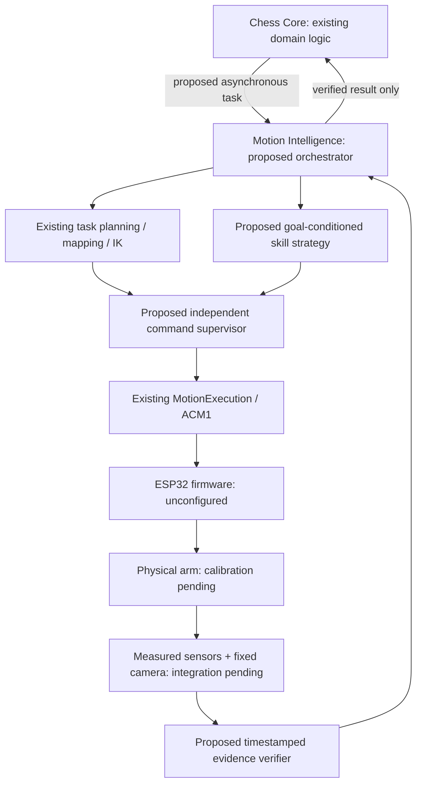
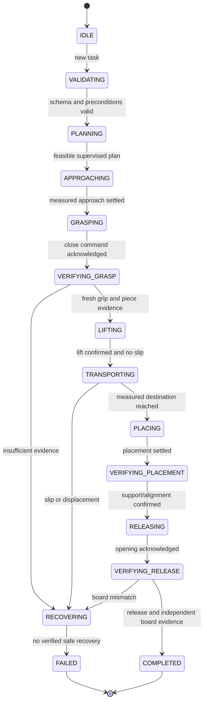

# Hybrid robotic manipulation: phase 1 audit and architecture

Date: 2026-11-05. Audited simulation baseline a953c71; fetched main 8d9894c.
Main was inspected as a reference, not merged during this audit. Preexisting
untracked simulation/learning remains preserved and is not the selected pipeline.

## Evidence and current capabilities

| Module/source | Present behavior | Missing verification |
|---|---|---|
| software/acchess | Chess state, legal moves, engine interfaces | End-to-end robot move confirmation |
| software/acmotion | Task decomposition, coordinate mapping, IK, segment execution/ACM1 | Calibrated board/robot geometry and live transport integration |
| software/integration/observation_interpreter | Interprets visual changes and can update Board | Transaction boundary for robot task completion; avoid premature Board mutation |
| firmware/esp32-s3-motion/include/robot_config.hpp | configured=false; motion/endstop/E-stop pins=-1; conversion constants=0 | Physical wiring, homing, measured feedback, independent stop/watchdog validation |
| firmware/esp32-s3-motion/src/main.cpp | Limit/E-stop input handling and command execution | No demonstrated encoders or grip sensor; command position is not measured position |
| simulation/mujoco | Direct stepping, gravity/contact, dynamic pieces, mesh-aligned coupled fingers | Actual servo linkage/J3/TCP, measured masses/inertias/actuator limits and collision fidelity |
| simulation/mujoco/experiment.py | Researcher Task protocol and Episode lifecycle | Gymnasium spaces, real task formulation, policy, training/evaluation/export |

The last verified suite had 31 passing MuJoCo tests including an isolated pawn
grasp/lift/release. It does not establish arbitrary board moves or generalization.
No new physical test, training, embedded inference or throughput measurement was
performed for this audit. Historical engineering inventory remains in
docs/audit/2026-10-30; its branch comparison predates main integration.

## Four-level architecture proposal



Training runs on the development workstation with direct MuJoCo API calls.
Embedded inference should share a process/device with task orchestration if
latency/memory measurements allow. Banana Pi M5 is a candidate, not selected.
Orange Pi/Raspberry Pi models and deployed workloads must be inventoried first.
ESP32 handles pulse timing, servo output and local faults, not policy inference.
ROS is optional integration infrastructure, not mandatory per physics step.

## Feedback inventory and fusion proposal

| Signal | Repository evidence | Treatment |
|---|---|---|
| Step counts/target | Firmware motion logic | Estimate only; not arrival proof |
| Endstop/E-stop | Config fields, no assigned pins | Unavailable until wired and tested |
| Encoders | No verified acquisition path | Add/calibrate if measured joint position is required |
| Grip contact/force/position | No verified sensor path | Select mechanically compatible sensing after CAD inspection |
| Camera observation | Vision library boundary exists | Calibrate fixed camera, measure confidence/latency/occlusion |
| MuJoCo poses/contacts | Available simulator truth | Oracle for tests only; label source explicitly |

Every observation needs source, sequence, monotonic timestamp, validity and
calibration revision. Require fresh grip evidence plus piece-relative stability
before lifting; monitor slip during transport. Confirm release using grip evidence
and stable destination observation after retreat. Compare all affected and
unaffected squares, not just source-empty/destination-occupied. Missing or
conflicting evidence blocks progression; diagnostics must identify the conflict.
Sensor thresholds/freshness/dwell times remain configuration decisions requiring
measurements. Current commands alone cannot satisfy any verification gate.

## Proposed execution state machine



All active states additionally transition to ABORTED on cancel, emergency,
watchdog, communication failure, unexpected collision or limit event. This is a
specification, not an implemented FSM. Recovery first stops/holds through the
controller, marks board state uncertain and reacquires evidence. Never retry a
grasp while holding an unverified piece. Retry budgets and safe poses must be
configured; unavailable recovery means intervention, not a guessed trajectory.

## Task protocol proposal

Logical asynchronous messages, no network transport selected yet:

```json
{"schema":1,"task_id":"move-0001","operation":"MOVE","piece_id":"white_pawn_e2","source_square":"e2","target_square":"e4","timeout_ms":30000,"expected_board_revision":42,"calibration_revision":"pending","parameters":{}}
```

```json
{"schema":1,"task_id":"move-0001","status":"FAILED","error_code":"FEEDBACK_UNAVAILABLE","eef_pose":null,"piece_pose":null,"grasp_confirmed":false,"release_confirmed":false,"visual_confirmed":false,"diagnostics":{"board_state":"uncertain"}}
```

Timeout is illustrative, not a validated operating limit. Accept task IDs once;
identical replay returns current/cached result without physical reexecution.
Same ID with changed payload is a conflict. Persist ledger before dispatch;
after restart reconcile in-progress work against observations instead of replaying.
Cancellation is idempotent and requires controller stop acknowledgement; a lost
connection cannot become COMPLETED. Captures are ordered child tasks with parent
ID and explicit intermediate expected states. Chess Core retains the pre-move
state until final physical reconciliation succeeds.

## RL formulation proposal and baseline

For the first reach experiment, use a goal-conditioned continuous bounded joint
increment action: delta_q = action * configured_speed * control_dt, with action
in [-1,1]. Independent supervisor checks position/speed/acceleration and freshness.
Current control_dt=0.02 s is simulation configuration, not a measured hardware
policy rate. Cartesian actions require reviewed IK/branch/singularity handling;
joint increments initially reuse existing position interfaces with fewer assumptions.

Candidate observation: q, qdot, tool/goal relative pose, opening, validity masks,
skill phase and observed piece state. Distinguish privileged simulation truth
from deployable sensor features. Hardware contract is 3R+Z+gripper; current
simulation 2R+Z+two coupled slides cannot yet represent that contract fully.

Baseline: deterministic IK plus bounded trajectory for reach, then contact-aware
grasp/lift/place orchestration. Reuse existing C++ IK only after frame/unit
compatibility is validated; do not silently substitute scene coordinates.
Dense progress shaping should use gamma*Phi(next)-Phi(current), with explicit
terminal handling; sparse verified success is separate. Penalize time, unsafe
contact, drops and limit excess. Weights, horizons and thresholds are unset;
write hand-checked reward ordering and exploit tests before tuning.

Compare PPO (fresh batches, simpler rollout accounting), SAC (replay/entropy,
continuous control, additional critics), TD3 (replay/delayed critics, deterministic
policy). None is selected or benchmarked. Start small CPU experiments only after
environment validation; report interaction count and wall time, not promises.

## Curriculum, metrics and deployment gates

| Phase | Exit evidence required |
|---|---|
| A Reach | Held-out goals; error, success, limit excess, collisions vs deterministic baseline |
| B Grasp/lift | Contact, stable hold, slip/drop and release detection; fault injection |
| C Generalization | Held-out squares, poses, piece types and contact conditions; distributions across seeds |
| D Composite moves | Verified placement, capture sequences, duplicates/cancel/timeouts/recovery tests |
| Sim-to-real | Measured frames/TCP/limits, masses/COM/inertia, actuation, sensor/latency calibration |
| Embedded inference | On-device p50/p95/p99 latency, RSS/CPU, model parity, offline load and overload behavior |
| Physical integration | Reduced-speed supervised bench evidence, independent stop and sensor verification |

Track grasp/transport/place/full-task success separately, position error, collisions,
drops, recovery rate, task time and resource cost. Separate training/selection/test
sets and record failures. Version task/reward/model/calibration/seed/config/checkpoint.
Randomize only justified uncertainty ranges, recording sampled parameters; ranges
must come from measurement or be labeled sensitivity studies. Randomization does
not repair incorrect mechanism geometry.

PyTorch eager and ONNX Runtime CPU are future deployment candidates. Export
requires preprocessing/action parity and numerical checks before on-device timing.
Quantization needs held-out accuracy/control validation. No runtime, hardware
placement or model format is selected without measurements. No paid/cloud service
is required. Existing dependency guidance is in simulation/docs/learning/dependencies.md.

## Developer handoff and sequence

1. Read this audit and ADR P004; reproduce current simulation using gripper-v6.md.
2. Implement typed task/evidence contracts, durable duplicate ledger and an FSM
   with fake clock/transport; inject stale evidence, slip, cancel and communication faults.
3. Add explicit simulator sensor adapters with provenance and configurable sensor
   delay/noise; never label oracle state as independent camera verification.
4. Validate geometry/reachability and a deterministic baseline with metrics.
5. Define Gymnasium spaces/reward and run checker plus deterministic replay tests.
6. Run controlled algorithm comparisons and document hyperparameters/results before
   selecting a policy. Earlier personal RL work is preserved, not silently reused.
7. Export/evaluate offline on actual SBCs only after a validated policy exists.
8. Close physical calibration/sensing/stop gates before any autonomous motor test.

Installation/simulation guides already exist. Training, export, embedded install,
sensor integration and full-move commands do not exist yet: do not invent CLI
instructions for these phases. Required diagrams for those phases must be added
with their implementations; the proposal above must not be presented as deployed.
