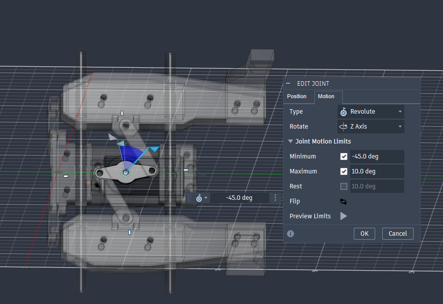
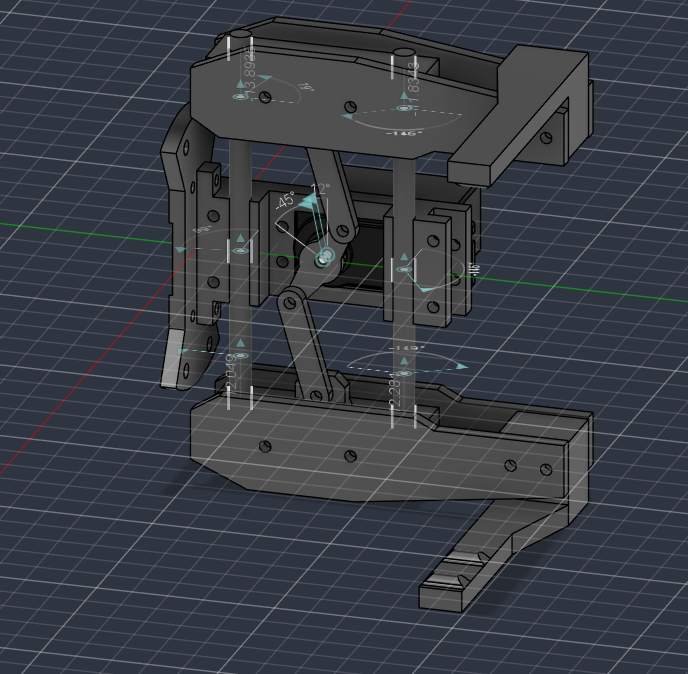
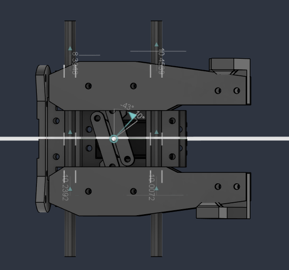

# Garra — evidências CAD recebidas em 30/10/2026

Fonte: três capturas enviadas pelo responsável, da montagem que ele identifica
como Arm_Assembly no Fusion. É evidência visual de CAD; ainda não vincula uma
revisão salva do arquivo ou um identificador nominal de junta.

## Confirmado na janela Edit Joint

| Campo | Valor visível | Interpretação |
|---|---|---|
| Type | Revolute | Junta rotacional |
| Rotate | Z Axis | Z do referencial local da junta; não necessariamente Z global |
| Minimum | -45.0 deg, habilitado | -π/4 rad = -0.7853981633974483 |
| Maximum | 10.0 deg, habilitado | π/18 rad = 0.17453292519943295 |
| Rest | 10.0 deg, desabilitado | Valor exibido, sem restrição de repouso ativa |

Amplitude angular: 55°, aproximadamente 0.9599310885968813 rad. O valor -45°
na prévia é uma configuração mostrada, não uma medida adicional de zero físico.
O desenho indica um mecanismo com elos entre acionamento e dedos; isso não
determina sozinho uma relação linear entre ângulo e abertura.

## O que não está identificado nessas capturas

- Nome/ID da junta, componentes pai/filho e se ela é a junta motora ou dependente.
- Transformação do frame da junta em relação à garra e ao último link do braço.
- Relações entre elos/dedos: articulações passivas, limites e acoplamentos.
- Qual extremo corresponde à garra aberta/fechada; largura em milímetros e
  correspondência entre ângulo CAD, ângulo do servo e gripperPercent do acmotion.
- Limites elétricos/mecânicos medidos no hardware, força, atrito e TCP.

As anotações sobrepostas nas duas últimas imagens não foram transcritas como
cotas definitivas: não há unidades/entidades suficientes para usá-las como
dimensões ou frames. Devem orientar inspeção da montagem, não substituir a extração.

## Uso na implementação

Estes limites serão aplicados à junta correspondente depois de identificá-la
na montagem. Não aplicar -45°..10° a J3 ou aos dois dedos por suposição. Não
modificar limites gerais do URDF com base nessa imagem. O próximo trabalho de
CAD é extrair árvore de componentes/juntas e coordenadas de suas referências,
registrando a correspondência com esta captura. A garra atual continua visual.

Decisão: [M002 — incorporar limites com rastreabilidade](adrs/M002-gripper-limits.md).
