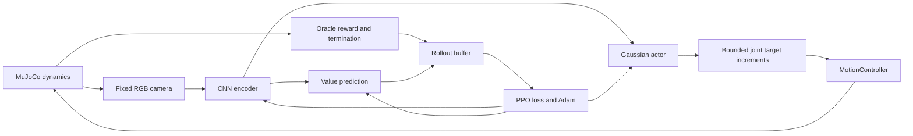

# Current ATOM training system

Current camera-guided implementation and test commands are in the
[MuJoCo README](../../simulation/mujoco/README.md). The material below records the
earlier v3 study baseline or its theoretical foundations.

Implementation baseline: commit `6953aa1`, environment version 3, inspected on
2026-11-05. This document describes that implementation; it is not a claim that
all roadmap features exist. Use the [operator guide](../hybrid-control/visual-grasp-rl-guide.md)
for commands and [the next steps](01-next-steps.md) for missing engineering work.

## What is implemented

| Component | Actual behavior | Source |
|---|---|---|
| Environment | Gymnasium environment, local E2 pawn task, two reset curricula | [visual_grasp_env.py](../../simulation/mujoco/src/atom_mujoco/visual_grasp_env.py) |
| Policy training | SB3 PPO with CnnPolicy; training, evaluation, resume, saved report | [train_visual_grasp.py](../../simulation/mujoco/training/grasp-lift/run.py) |
| Observation | uint8 RGB, channels-first `(3,96,96)`, fixed close camera | Environment `observation`, `render`, `reset` |
| Learned action | Four bounded joint-reference increments | Environment `step` |
| Low-level execution | Existing MotionController; simulated bias-force feedforward and rate-limited reference | [motion_controller.py](../../simulation/mujoco/src/atom_mujoco/motion_controller.py), [backend.py](../../simulation/mujoco/src/atom_mujoco/backend.py) |
| Live monitoring | 3D viewer, exact policy pixels, pause/stop, JSON/JSONL progress | [training_monitor.py](../../simulation/mujoco/src/atom_mujoco/training_monitor.py) |
| Replay | Version/hash checks and deterministic policy inference | [replay_visual_grasp.py](../../simulation/mujoco/training/grasp-lift/evaluate.py) |
| User launcher | Windows PowerShell; visible by default, headless optional | [Start-RLTraining.ps1](../../simulation/mujoco/scripts/Start-RLTraining.ps1) |
| Production chess execution | RL remains disabled; only baseline accepted by Playground | [playground.py](../../simulation/mujoco/src/atom_mujoco/playground.py) |

The oracle path supervises learning; it is not an image-derived success verifier.
The 3D inspection camera is separate from the fixed policy camera. The policy
has no goal-square input, no recurrent memory, and no acvision feature input.

## Neural network, inspected from a saved checkpoint

The checkpoint contains an `ActorCriticCnnPolicy` using a shared NatureCNN feature
extractor. Shared extractor aliases in a printed PyTorch module do not imply three
independent CNNs. For a 96x96 RGB input the encoder is:

| Layer | Output shape excluding batch |
|---|---|
| Input, normalized by SB3 image preprocessing | 3 x 96 x 96 |
| Conv2d, 32 channels, 8x8 kernel, stride 4; ReLU | 32 x 23 x 23 |
| Conv2d, 64 channels, 4x4 kernel, stride 2; ReLU | 64 x 10 x 10 |
| Conv2d, 64 channels, 3x3 kernel, stride 1; ReLU | 64 x 8 x 8 |
| Flatten | 4096 |
| Linear + ReLU | 512 |
| Actor linear head | 4 action means |
| Critic linear head | 1 value estimate |

The Gaussian actor also learns four log standard deviations. Its exploration is
not a piece detector, a language model or a chess engine. Training samples
stochastic actions; evaluation calls `predict(..., deterministic=True)`. In this
setup sampled actions can be clipped to the action-space bounds before they
reach the environment. Measure saturation before attributing all behavior to a
smooth Gaussian control law.

## Action and timing contract

`a = [a_J1, a_Z, a_J2, a_finger]`, each component in [-1,1]. Per decision:

    target[:3] += action[:3] * [0.008 rad, 0.002 m, 0.008 rad]
    target[3:] += action[3] * 0.001 m
    target = clip(target, lower_joint_limits, upper_joint_limits)

Both fingers receive the same joint-reference increment. Finger coordinates are
signed per-finger slide positions, not total jaw width. Commands are targets,
not guaranteed achieved displacements. Rate limits, servo dynamics and contact
resistance determine the actual motion. The environment advances five control
intervals per action. In the present bundle each interval is 0.02 s, so decisions
are nominally 10 Hz in simulated time. The physics timestep is 0.002 s.

The default horizon is 100 decisions, about 10 simulated seconds excluding reset.
A rollout of 128 transitions can cross several episodes. It is not 128 episodes.
A PPO update reuses that rollout in batches of 32 over four epochs: ordinarily
16 minibatch optimizer steps. SB3's `n_updates` counter tracks epochs, so it is
not necessarily the number of individual Adam calls.

## Reset curricula

`lift` settles the initial scene, solves a reset-only IK placement at the proxy
stem, pre-shapes the jaws, introduces small joint offsets, closes and verifies
bilateral pad contact. The policy begins with a prepared grip. This is privileged
curriculum staging, not a learned approach or grasp.

`grasp` starts 8 mm above the proxy grasp point, with pre-shaped open jaws and no
prepared bilateral grip. It must learn the descent/closing/lifting behavior.
Both stages are fixed to `white_pawn_e2`, rather than arbitrary pieces or targets.
Initial arm offsets are sampled within +/-[0.003 rad, 0.0005 m, 0.003 rad].
A reset that disturbs another piece beyond 8 mm is rejected; lift reset also
rejects missing bilateral contact. The camera look-at is established once and
not tracked to follow the moving piece. The initial piece height is measured
after settling. Piece poses are preserved when staging the arm.

## Version-3 reward and termination, exactly

Let d be the TCP-to-proxy-grasp-point distance in metres, h the selected piece's
height change from its settled initial position, and g=1 for bilateral pad contact
and 0 otherwise. The current potential is:

    Phi = -20*d + 40*clip(h, 0, 0.05)*g + g
    reward = Phi_next - Phi_previous - 0.01 - 0.002*sum(action**2)
             + 10*success - 5*disturbed

`success` requires bilateral contact and h > 0.035 m for three consecutive
observations. `disturbed` means another piece moved over 0.008 m in Euclidean
position from its pre-staging settled pose. Either success, disturbance or the
selected body's origin falling below world z=0 terminates the episode. Reaching
the horizon truncates it. The disturbance predicate does not measure every
contact, small displacement or rotation; it is not a full damage/collision metric.

Version 2 paid for partial lift every step; version 3 uses a potential difference
to reduce that incentive. This is **not** an implementation of the discounted
policy-invariance shaping theorem: the code uses Phi_next-Phi_previous rather
than gamma*Phi_next-Phi_previous, and terminal potentials require careful
handling. Audit reward incentives experimentally. See [theory](02-theory.md).

## PPO settings: explicit and inherited

Inspected using SB3 2.9.2 and the saved checkpoint, not inferred from the name PPO:

| Setting | Value |
|---|---|
| Learning rate | 0.0003 |
| Rollout length / batch / epochs | 128 / 32 / 4 |
| gamma / GAE lambda | 0.99 / 0.95 |
| PPO clip range | 0.2 |
| Advantage normalization | enabled |
| Entropy coefficient / value coefficient | 0.0 / 0.5 |
| Maximum gradient norm | 0.5 |
| target_kl | None: no configured KL early-stop threshold |
| Optimizer | Adam, betas (0.9,0.999), epsilon 1e-5, no weight decay |

Several settings are library defaults, not pinned arguments in the training
script. A future dependency change must record resolved settings before claiming
comparability. Exploration still exists when the entropy coefficient is zero;
zero disables an explicit entropy bonus, not Gaussian action sampling.

## Evidence, not qualification

The committed [version-3 128-step report](../hybrid-control/visual-lift-v3-128-report.json)
shows updated parameters, CUDA execution on the RTX 5070 Ti, checkpoint reload
parity, and 0/1 held-out successes. That short run tests the pipeline, not skill.

An **in-progress snapshot** of `visual-lift-camera-v3-20000` inspected on 2026-11-05
showed cumulative step 3328, 97 training episodes and 90 training successes.
It resumed a 128-step pilot. These are training-time counts from `progress.json`,
not a frozen evaluation or a permanent statement of the run's latest state.
The current launcher evaluates only five fixed held-out reset seeds at the end.
Even 5/5 would characterize a narrow task and would not qualify deployment.

Five environment/monitor tests passed for the implementation. Scripted upward
actions demonstrate physical feasibility in the lift curriculum; they do not
prove learned visual feedback. The Windows automation helper listed the training
windows but screenshot/activation checks timed out, so UI button clicks were not
verified. Pause/stop logic and the STOP-file save path were tested separately.

## Information available in simulation versus the robot

| Information | Actor input? | Used elsewhere today? | Available from a fixed real camera alone? |
|---|---|---|---|
| RGB frame | Yes | Viewer | Yes, with a different rendering/noise distribution |
| Exact piece position and identity | No | Reset, reward, success, disturbance | Must be estimated; not automatically known |
| Bilateral fingertip contacts | No | Reset and success oracle | Not directly measured |
| Joint positions and bias forces | No | Simulator/controller | Not directly measured by the described hardware |
| Logical legal moves | No | Chess integration outside training | Supplied by ac:chess |
| Goal square | No | Not part of this task | Needs a future task/goal interface |

Camera-only **policy observation** is not camera-only execution of the whole
stack. The current low-level controller uses simulator joint information and
model bias forces. Its hardware equivalent has not been validated. A fixed
camera cannot generally observe every joint or hidden contact at every instant.

## Boundaries that must remain explicit

The experiment does not invoke acvision BoardDetector or PieceDetector for its
observations. The camera renderer is the observation provider. The isolated
training episode does not publish official ac:chess moves or commit production
physical-board transactions. Its actions are not the production swept planner's
collision-certified trajectories. Physics and fingertip contacts are active;
experimental geometry, limited collision coverage and uncalibrated parameters
remain. This checkpoint cannot be described as a physical robot controller.
