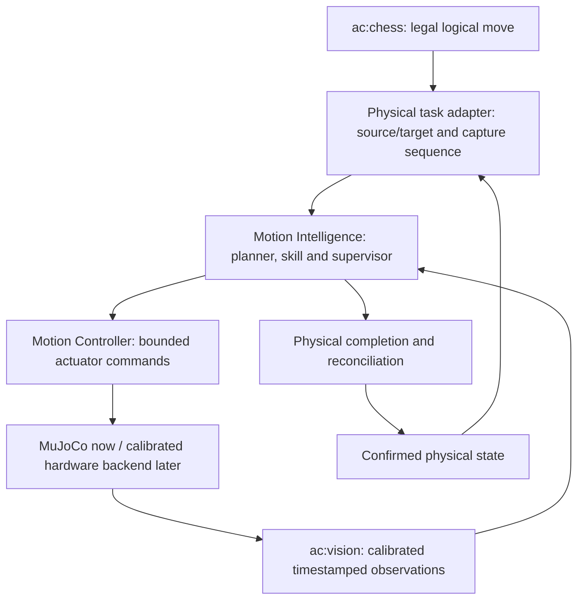

# Robot physics, camera feedback and sim-to-real

Current camera-guided implementation and test commands are in the
[MuJoCo README](../../simulation/mujoco/README.md). The material below records the
earlier v3 study baseline or its theoretical foundations.

The purpose of learning is to control a real mechanism, not merely to exploit a
renderer. Separate the geometry, dynamics, observation and command models, then
measure their errors. The current ATOM training scene is an experimental prototype.
This page is a design and study guide; it does not certify physical fidelity.

## 1. Reference frames and kinematics

Define world, robot base, each link, tool center point (TCP), camera, board and
Graveyard frames. A rigid transform T_AB maps coordinates from frame B to A.
Write transform direction and units explicitly. If p_C is a camera-frame point,
then p_B=T_BC*p_C in homogeneous coordinates. Confusing T_BC with its inverse can
produce a plausible animation and a physically wrong target.

Forward kinematics maps joint coordinates to pose. A Jacobian maps small joint
velocity changes to tool velocity; its null spaces and singular values explain
unreachable directions and sensitivity. Damped least squares controls numerical
amplification near a singularity but does not create reachability, avoid an
obstacle, or recover an unmeasured joint zero. TCP geometry is part of the model:
a link-frame origin is not automatically the midpoint between the fingertips.
Study the [Modern Robotics author material](https://modernrobotics.northwestern.edu/)
and verify results against measured points on this specific arm.

## 2. Dynamics and actuator response

A schematic rigid-body equation is:

    M(q)*q_ddot + C(q,q_dot)*q_dot + gravity(q)
      = actuator_torque + contact_generalized_forces

The simulator also includes actuator laws, damping, limits and numerical solver
choices. Joint targets pass through those dynamics; they are not instantaneous
positions. Mass/inertia, motor force limits, gearing, backlash, compliance and
friction influence grip and transport. A visual CAD mesh supplies shape, not all
these parameters. A convincing mesh does not establish the correct center of
mass or inertia tensor.

Measure quasi-static response, settling, hysteresis and response at different
loads. Fit a simple identifiable actuator model before adding complexity. Keep
fitting data separate from validation trajectories. Finite motor force, delay
and missed steps should not be silently replaced by ideal state access. For
control/optimization background use [Underactuated Robotics](https://underactuated.mit.edu/).

## 3. Grasping is a contact problem

The simplified Coulomb relation |F_t|<=mu*F_n describes a friction constraint,
not a complete model of rubber pads or 3D grasp stability. With two symmetric
contacts, the rough vertical-support condition 2*mu*F_n>=m*g illustrates why
mass, normal force and friction matter. It ignores moment balance, accelerations,
contact geometry and compliance, so it is not a hardware grip-force prescription.

A contact can resist some combinations of force/torque and fail under others.
Study wrench balance, friction cones, support regions and slip. MuJoCo's contact
dimensionality and solver parameters affect the simulated behavior; use its
[computation documentation](https://mujoco.readthedocs.io/en/stable/computation.html)
when reasoning about those settings. Do not tune friction solely until a desired
video succeeds and then call the parameters calibrated.

ATOM currently retains fingertip-only gripper contacts by explicit project
choice. This prevents some previously bad hull interactions but omits other
surfaces of the real gripper. Whole-arm/self-collision and all physical contact
coverage are not established. A policy can exploit any missing surface or overly
soft contact. Changing this model requires new physical-feasibility tests and
new training/evaluation distributions.

## 4. Geometry, collision checking and learning

Reachability asks whether a tool pose can be attained. Collision checking asks
whether the robot and carried object can follow a path without violating the
modeled clearances. Dynamic execution adds tracking error and contact effects.
All three questions differ. A local grasp policy cannot be assumed to solve the
full swept-path problem or restore a planner's clearance after a correction.

The existing deterministic preflight and runtime checks form a useful baseline.
The isolated RL environment does not call that preflight for every exploratory
action. Its disturbance penalty is not collision certification. Proposed residual
control should bound corrections and recheck the resulting path/contact
conditions. Any object held by the tool must be included in the swept volume.
Board, pieces and occupied Graveyard slots all matter.

## 5. Camera geometry

For an ideal calibrated pinhole camera:

    z_c * [u,v,1]^T = K * [R|t] * [X,Y,Z,1]^T

K contains intrinsics, while R/t relate spatial frames. Real lenses introduce
distortion; focus, resolution and image resizing affect calibration. If a frame
is cropped or resized, transform the intrinsics or use an explicitly calibrated
image pipeline. Test projection and backprojection with held-out measured points.
The [OpenCV calibration tutorial](https://docs.opencv.org/4.x/dc/dbb/tutorial_py_calibration.html)
is a practical starting point.

A homography maps points between a plane and its image. It is useful for square
centers on a flat board, but does not recover arbitrary 3D coordinates. Applying
a board-plane homography to the top of a tall piece can introduce parallax error.
An airborne piece requires height/pose information or a justified constrained
model. Fiducials or known corners can anchor board orientation; their printed
size, physical placement and identification must be measured.

For a future fixed board, register the actual square pitch, board origin, base
height and camera-to-board/robot transforms. Calibration is a stored, versioned
measurement with uncertainty and a validation date. It is not an image that
"looks aligned". Repeat calibration after changing the camera, board or robot
mount and test how drift is detected.

## 6. Observability with one camera and no encoders

Images can help estimate tool/object motion when the relevant features are
visible and distinguishable. They do not provide direct bilateral contact force
or guaranteed visibility through an occluder. A single frame generally does not
identify velocity. Camera latency and exposure mean a frame describes an earlier,
possibly blurred state. A measurement's timestamp and uncertainty are part of
its meaning.

The described hardware has no joint encoders or grip sensor beyond the camera.
Pulse counts and last commands can predict a joint estimate, but slip, missed
steps and backlash can invalidate it. A hidden distal joint can remain ambiguous
in a single view. Whether vision is sufficient depends on geometry, camera view,
speed, required precision and failure tolerance; it must be demonstrated.

Possible mitigations include visible tool fiducials, a changed view, constrained
motion, short observation pauses, a second camera or added reference/contact
instrumentation. These are design options, not already installed features. A
state estimator should represent uncertainty and missing data rather than output
a falsely precise pose on every frame. Loss of evidence must not be interpreted
as successful motion.

## 7. Time and control architecture

Separate a fast actuator loop from a slower visual estimation/task loop. Commands
and measurements need sequence numbers, timestamps and freshness rules. An
acknowledgment can mean accepted, started, or completed; define which. It does
not by itself prove physical arrival or grip. Measure end-to-end delay rather
than assuming a nominal camera frame rate equals control bandwidth.

The current simulated MotionController reads exact simulator joint state/bias
forces. A physical backend needs its own calibrated command mapping and a
feedback design. Deploying only the neural `policy.zip` does not reproduce the
surrounding simulator controller. Profile inference on the intended onboard
computer, including image capture/preprocessing and communication, not just
forward-pass time on the workstation GPU.

## 8. Recommended hybrid responsibility split

This is a target integration boundary, not a claim the deployed feedback arrows
exist today. Keep chess legality in ac:chess. Keep physical occupancy and identities
in the physical store. Hold an operation in executing/recovery until evidence
supports placement/release; only then commit its result. Capture decomposition,
castling and Graveyard transfers remain physical task sequences, not new chess
rules inside the policy.

## 9. Domain randomization and system identification

Identification estimates plausible parameters from measurements. Randomization
samples uncertainty around a justified model/distribution. Both are useful;
randomization is not an excuse to invent unlimited masses, friction or camera
positions. Excessive variation can make the task impossible or teach irrelevant
robustness. Too little variation can hide brittle memorization.

Start with measured ranges for square pitch, robot/board transform, actuator
response, delay, object mass, surface friction and camera imaging. Separate
visual changes from dynamics changes to diagnose failures. Evaluate combinations
and out-of-range conditions explicitly. Record which parameters were randomized
at reset, which vary during an episode, and which are observed by the policy.
For an original visual-transfer example see [Tobin et al.](https://arxiv.org/abs/1703.06907).

## 10. Staged physical introduction

A proposed sequence is camera/board calibration with motors disabled, observed
empty-space motion, isolated object manipulation at limited speed, release/support
verification, nearby obstacles, then complete chess tasks. Each stage needs
measured stopping behavior, bounded commands and an independent fault/stop path.
No automatic promotion is justified by a simulated reward threshold. If physical
observability is inadequate, change the sensing or task constraints before
increasing autonomous complexity.

Train in simulation; deploy a frozen policy under supervision first. Online
weight updates on hardware are a separate research proposal with data and fault
requirements. An unqualified random policy should not explore the assembled arm.
This is a direct consequence of this project's simulation-to-hardware gap, not a
claim that all robot learning must use the same deployment method.
