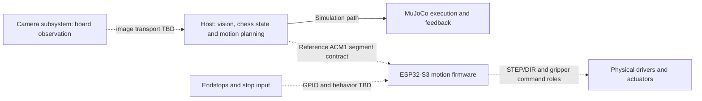
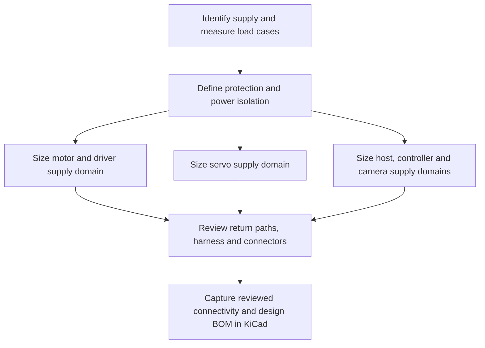

# Architecture and interfaces

The diagrams describe functional boundaries. Arrows represent intended data flow
or design responsibilities. Physical assignments remain open in the
[assembly record](../inventory/assembly.yaml).

| Boundary | Repository evidence | Open decision |
| --- | --- | --- |
| Camera to host | Inventory reports an ESP32-CAM family board | Exact board, sensor, mount, calibration and transport |
| Host to controller | [ACM1 reference firmware](../../firmware/esp32-s3-motion/README.md) | Controller assignment, axis order, units, timing and fault handling on the physical rig |
| Controller to actuators | Reference firmware defines J1/J2/J3/Z and gripper roles | GPIOs, driver/axis allocation, polarity, conversion and homing |
| Simulation to hardware | [MuJoCo joint guide](../mujoco-integration.md) | Evidence-backed assignment for every joint and tool reference |

The firmware starts with movement disabled. Its J3 role, the optional simulated
wrist and the coupled simulated fingers need explicit reconciliation before
assigning any physical motor.

## Power design responsibilities

The inventory reports a 12 V / 10 A supply and a lot of DRV8825-compatible
carriers. Check labels, carrier revisions and sense resistors, then establish
load, transient, thermal and protection requirements per domain. Document the
stop function and power isolation independently from the firmware input. The
legacy drawing provides context for the design review.

## Mechanical hierarchy in simulation

Wrist-enabled bundles insert the wrist joint at the gripper mount. Inspect the
specific bundle manifest for joint and actuator identities. The physical
assembly requires measured frames, travel, zero references, linkage and TCP.
