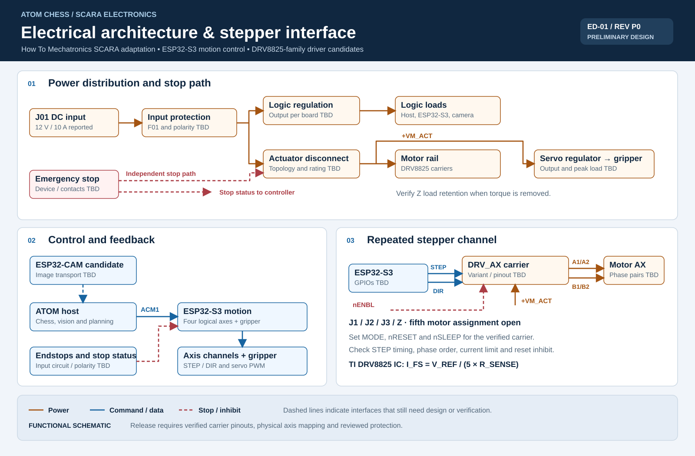

# ATOM SCARA electrical design sheet ED-01

Revision P0 · Preliminary design review · Basis: SCARA adaptation and ATOM inventory
· Scope: low-voltage distribution, repeated stepper channel, I/O and verification.

All nets and reference designators on this sheet are proposed. Carrier terminal
positions, GPIO numbers, protection values and physical axis assignments are
open. Use the [blueprint](electronics-blueprint.md) for the comparison with the
original design and connector schedule.

[Open the full-size ED-01 engineering drawing](diagrams/ed-01-electrical-architecture.svg).



## E01 — Power tree and return domains

```text
                         J01 DC IN (12 V reported)
                            │ +VIN_RAW / 0V_IN
                      [F01 + input protection]     F01 value TBD
                            │ +VIN_PROT
             ┌──────────────┴────────────────────┐
             │                                   │
    [Logic conversion]                  [Actuator disconnect]
      │ V_LOGIC[k]                         │ +VM_ACT
      ├─ host                              ├─ DRV_J1/J2/J3/Z
      ├─ ESP32-S3                          │  local bypass + bulk
      └─ ESP32-CAM                         └─ [Servo conversion] ─ V_SERVO
    STOP loop ──► disconnect control; status ──► ESTOP_STATUS interface
```

| Net | Source and load | Design record required |
| --- | --- | --- |
| `+VIN_RAW`, `0V_IN` | Supply output and input protection | Label rating, connector, polarity, source tolerance and short-circuit behavior |
| `+VIN_PROT` | Protected feed to logic conversion and actuator disconnect | Input protection rating, inrush, reverse polarity and transient strategy |
| `+VM_ACT`, `0V_PWR` | Disconnect to motor drivers and servo regulator | Simultaneous load, cable drop, local capacitance and VM transient envelope |
| `V_LOGIC[k]`, `0V_SIG` | Logic converter outputs to identified boards | Voltage at each load, converter efficiency, peak current and USB backfeed behavior |
| `V_SERVO`, `0V_SERVO` | Servo regulator to J41 | Measured peak current, voltage sag and effect on controller resets |

Return names mark current paths for review. Define the reference connection or
isolation at each signal boundary on the schematic. Route winding and servo
return current away from signal reference paths. Review cable and connector
current ratings, voltage drop and protection coordination together.

For each simultaneous load case, use
`I_IN ≈ sum(P_LOAD[k] / eta[k]) / V_IN` as the initial DC input estimate.
Use measured driver input power for the motor branch and verify transients at
the carriers. Winding current is a separate quantity. Estimate cable drop
with `ΔV = I × R_loop` using the complete feed and return path. Record start,
hold, multi-axis motion, servo peak and stop transients. Compare against each
selected part's ratings and the declared operating envelope.

## E02 — Repeated stepper channel

Repeat for AX = J1, J2, J3, Z. Release an extra sheet only after the fifth
motor and its physical role are identified.

```text
ESP32-S3                 DRV_AX carrier                     Motor J2x
AX_STEP ───────────────► STEP                          A1 ─── phase A end 1
AX_DIR  ───────────────► DIR                           A2 ─── phase A end 2
AX_nEN  ───────────────► nENBL (proposed hardware)     B1 ─── phase B end 1
AX_nFLT ◄─────────────── nFAULT (if exposed)           B2 ─── phase B end 2
+VM_ACT ───────────────► VM
Reference ───────────── GND
MODE[2:0], nRESET, nSLEEP ── defined states per exact carrier
```

| Interface | Design constraint | Verification |
| --- | --- | --- |
| STEP and DIR | Check ESP32 output levels against carrier input thresholds. Respect STEP high/low and DIR setup/hold. | Scope at the carrier at maximum command rate. |
| nENBL | Proposed inhibit asserted during MCU reset, brownout and invalid configuration. Check carrier bias and logic while MCU is unpowered. | Capture enable, STEP and VM at boot and power cycling. The present firmware has no enable pin assignment. |
| nFAULT | If exposed and electrically compatible, route through the verified pull-up or translation network. | Check asserted/deasserted levels and controller behavior. Firmware integration is pending. |
| MODE, nSLEEP, nRESET | Document carrier straps, power-on states and wake delay. | Verify physical straps and first accepted STEP pulse. |
| A1/A2 and B1/B2 | Map each winding pair to a channel by measurement and label both cable ends. | Record pair resistance, phase order and observed direction under a reviewed bench setup. |

For a verified TI DRV8825 circuit, `I_FS = V_REF / (5 × R_SENSE)` is the
full-scale winding current threshold. Identify the sense resistor and actual
VREF point on each carrier. Select the threshold against both the motor phase
rating and the carrier thermal capability. The CI formula does not determine
a usable setpoint until those inputs are known. Use the
[TI DRV8825 datasheet](https://www.ti.com/lit/ds/symlink/drv8825.pdf), sections
7.6 and 9.2, for timing and current regulation.

Define `N` as full steps per motor revolution, `µ` as microsteps per full
step and `G` as motor revolutions per output revolution. Record
`steps/rad = N × µ × G / (2π)` for revolute axes and
`steps/mm = N × µ × G / L` for Z, where `L` is travel in millimetres per
output revolution. Convert commanded speed to STEP frequency using the same
calibration. Keep direction inversion and home reference in the axis record.

## E03 — Discrete I/O and fault states

| Net | Interface intent | Release evidence |
| --- | --- | --- |
| `AX_LIMIT_IN` | Endstop input per axis. Contact type, bias, filtering and polarity TBD. | Verify both travel state and cable-open behavior. Confirm input voltage at GPIO. |
| `ESTOP_STATUS` | Feedback from the stop circuit to the motion controller. | Verify status with actuator supply isolated and after reset. |
| `GRIP_PWM` | ESP32-S3 to servo control input with a verified reference. | Scope signal with servo load and record usable pulse range from measured travel. |
| `ACM1_LINK` | Host to motion controller. Physical USB/UART routing TBD. | Verify reconnect and behavior on loss of communication during a segment. |

| Event | Proposed design requirement | Current evidence |
| --- | --- | --- |
| Power-on or MCU reset | Inhibit motion until explicit arming from a valid state. | Firmware ships with configuration disabled. Hardware inhibit remains to be designed. |
| Limit asserted | Halt commanded motion and require recovery appropriate to the axis. | Firmware checks configured limit inputs. Wiring and polarity remain open. |
| Emergency stop | Isolate actuator power through an independent path and prevent automatic restart. Assess Z load retention. | Firmware checks a stop input. Isolation circuit and retention behavior are unverified. |
| Host link lost or driver fault | Define stopping behavior, fault latch and operator recovery. | Verify the released firmware and carrier implementation under fault injection. |

## E04 — Review records

For each axis record motor ID, carrier ID, connector and GPIO assignment,
phase ratings, sense resistance, VREF, microstep straps, direction, conversion,
home and measured timing. For each power rail record the limits, load cases,
cable drop, peak/steady measurements, protection and acceptance margin. Attach
scope traces and physical evidence to the assembly revision. Use the
[verification gates](verification.md) to sign off schematic, harness and
bench results before issuing a wiring revision.
