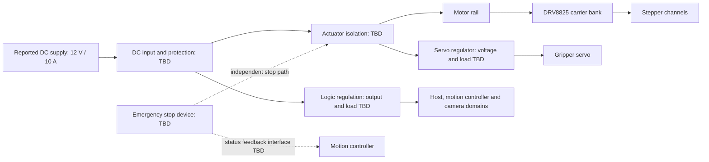
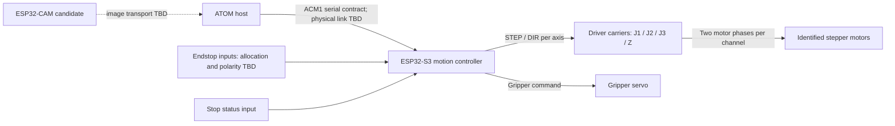

# ATOM SCARA electronics blueprint

Revision 0.1 · Design baseline · Pin assignments and installed hardware pending verification

This blueprint adapts the [How To Mechatronics SCARA circuit](https://howtomechatronics.com/projects/scara-robot-how-to-build-your-own-arduino-based-robot/#scara-robot-circuit-diagram)
to the ATOM Chess architecture. It defines power domains, signal interfaces and
the connector schedule to complete before releasing a wiring schematic.

## Original SCARA and ATOM changes

| Function | Original SCARA | ATOM design baseline |
| --- | --- | --- |
| Motion controller | Arduino UNO and CNC Shield | ESP32-S3 reference firmware. Two boards reported in inventory. Select the installed board and exact pinout. |
| Stepper drivers | Four A4988 | DRV8825-family carriers reported. Firmware defines four channels. Historical drawing shows five drivers. Confirm carrier count, variant and allocation. |
| Stepper motors | Four NEMA 17 | Five motors reported on hand. Frame, phase ratings and assignment are open. |
| Gripper | MG996R servo | One servo reported. Exact model, pulse limits, supply requirements and linkage are open. |
| Host and vision | Processing GUI | ATOM host runs chess, planning and vision. Historical drawing names Banana Pi M5 and Orange Pi. Select the actual host. ESP32-CAM is a reported camera candidate. |
| Host link | Original Arduino control path | Current firmware implements the ACM1 serial contract. micro-ROS appears in the historical drawing. |
| Supply | 12 V design | 12 V / 10 A supply reported. Historical drawing shows two 12→5 V converters. Confirm regulators and load budgets by domain. |

ATOM sources: [inventory](../inventory/components.yaml), [assembly](../inventory/assembly.yaml),
[historical electronics drawing](../Architechture/Eletronic/v0.0/v0.0%20eletronic%20diagram.svg),
[engineering audit](../../docs/audit/2026-10-30/bom-electrical.md), and
[ESP32-S3 reference firmware](../../firmware/esp32-s3-motion/README.md).

## Sheet 1 — Power distribution and stop functions

This is a proposed split for review. Confirm the DC input connector, polarity,
overcurrent protection and the load envelope for each branch. Verify the
controller, camera and host input requirements individually before assigning
them to a common rail. Specify the servo regulator against the identified
servo's peak load. The legacy 100 µF marking is a design reference. Select
local bypass and bulk capacitance against the exact carrier and supply wiring.

Define power and signal return paths on the schematic, including USB return and
possible backfeed paths. Review the response to stop, power loss and restart,
including whether the vertical axis can move when motor torque is removed.
The ESP32-S3 stop input provides a software interface. The actuator isolation
device and its behavior need independent design and bench verification.

## Sheet 2 — Control and feedback

The [firmware configuration](../../firmware/esp32-s3-motion/include/robot_config.hpp)
ships with movement disabled and pin assignments unset. Treat J1/J2/J3/Z as
logical labels until the assembly record ties them to physical motors. Resolve
the role of the fifth motor and how the simulated wrist corresponds to the
physical mechanism before allocating another channel. For each carrier confirm
logic thresholds, enable/reset/sleep behavior, microstep straps, phase pairs,
sense resistance and current limit using the exact carrier documentation and
motor rating. Keep these choices tied to the firmware conversion factors.

## Sheet 3 — Draft harness schedule

The IDs below are proposed connector references for the first KiCad schematic.
Pin numbers, conductor size, connector models and terminal order are TBD.

| ID | From → to | Signals or functions to resolve |
| --- | --- | --- |
| J01 | Supply → distribution | DC input positive and return, connector polarity and protection |
| J02 | Host → ESP32-S3 | ACM1 serial transport, USB or UART decision, reference and power behavior |
| J11–J14 | ESP32-S3 → carriers for J1/J2/J3/Z | STEP, DIR, signal reference and enable strategy |
| J21–J24 | Carriers → motors for J1/J2/J3/Z | Phase A pair and phase B pair, measured winding identity and direction |
| J31–J34 | Endstop channels → ESP32-S3 | Contact type, reference, bias, filtering, active state and broken-wire behavior |
| J41 | Servo supply and ESP32-S3 → gripper | Servo supply, return and control, verified connector order |
| J51 | Stop device → isolation and status circuits | Independent actuator isolation and controller feedback |
| J61 | Logic distribution → camera and host interfaces | Identify separate supply entries, return and camera data path |

Capture connector pin tables and net labels after board selection. For each
harness include both endpoint designators, mating part numbers, pin order,
conductor and strain relief. The [BOM register](bom.md) tracks known parts.
The electrical BOM should come from the reviewed schematic.

## Inputs needed for the wiring revision

1. Confirm which axes are physically installed, where the fifth motor goes, and
   which motor label belongs to each axis.
2. Record labels and both sides of the ESP32-S3, each driver-carrier variant,
   supply, regulators, camera and servo. Record the actual host model and link.
3. Document the current switch and stop devices, any existing wiring, and the
   desired behavior of the vertical axis during a stop or power loss.
4. Resolve each TBD in the connector schedule, then release schematic sheets,
   design BOM, harness schedule and bench test evidence together. Use the
   [hardware verification gates](verification.md) for release criteria.
