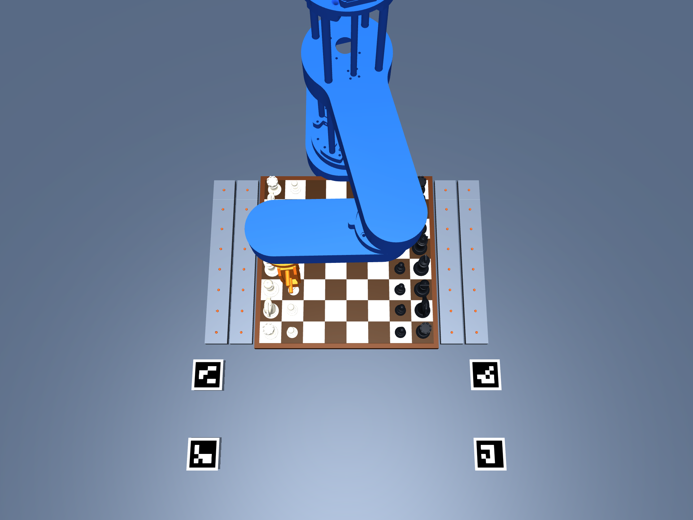
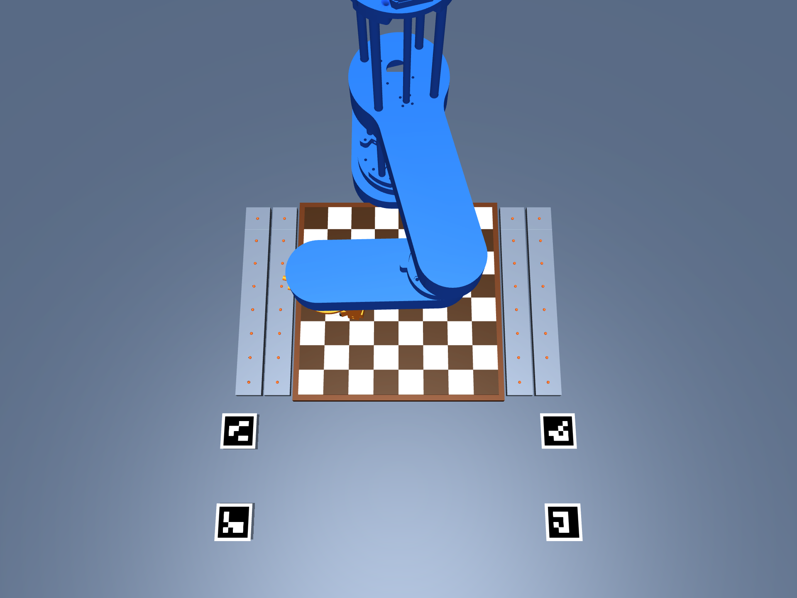

# Crowded planner-started reach and grasp diagnosis — 2026-11-21

The resumed run completed 1,024 new PPO decisions on the 32-piece starting
position. Reach evaluation was 8/8 before, 8/8 after and 16/16 on additional
seeds. These are **contact-free e2 reach results, not grasp/lift/transfer**.
The reward threshold is a 17.5 mm mean pad gap. Both baseline and trained policy
already pass this small test; the counts do not demonstrate a PPO advantage,
general reliability, a complete game or hardware readiness.

## Measured reach results

| Test | Completed successes | Median best mean pad gap |
| --- | --- | --- |
| Before this update, seeds 980000–980007 | 8/8 | 17.254 mm |
| After this update, same seeds | 8/8 | 16.837 mm |
| Additional assessment, seeds 981000–981015 | 16/16 | 16.835 mm |
| Training episodes completed during 1,024 decisions | 44/44 | See raw episode records |

All 1,024 proposals were accepted; no training episode reported a topple.
Training took 514.16 s, including 1.59 s in PPO optimization. This is a small
vector MLP initialized from previous weights; camera perception, validation and
executed approach resets dominate wall time. Increasing GPU optimizer capacity
alone would not address those measured costs.

The prior 2,048-decision process ended without a final report. Its checkpoint
at decision 1,024 was verified against the SHA sidecar, loaded successfully and
checked against the recorded configuration/runtime/assets before continuation.
This continuation loads **weights with a fresh optimizer**, not the exact
interrupted process/RNG state. Later unpersisted decisions are not counted as
recovered training. The new final checkpoint SHA-256 is
`405f21a7880f76a0c13d215f4bad49bf86d281ee8e38d2fc7f10a3a4468d9d78`.

[summary.json](summary.json) contains source report/configuration identities and
local run paths. [reach-evaluation.csv](reach-evaluation.csv) contains the actual
per-seed counts, gaps, contacts, lift flags and neighbor displacements. Raw
checkpoints and the complete telemetry CSVs remain in the originating run.

## Failure sequence before the isolated lift

The earlier diagnostics exposed two separate failure classes:

1. **Crowded entry geometry.** The upper-head diagnostic aligned the wrist and
   centered above e2, then rejected descent because a moving-finger hull was
   within the 1 mm margin of the d2 pawn head (reported distance 0.753 mm).
   It did not execute that descent or attempt closure. A bounded screen of
   2,425 parameter records found no valid aperture/closure endpoint pair in its
   tested head latitudes, XY offsets, wrists and elbow branches. This finite
   search does not prove that every physical grasp is impossible.
2. **Isolated contact/lift.** At preload factor 1.5, the original 1 mm margin
   rejected closure at a target-to-finger hull distance of 0.997 mm. Factors
   1.4/1.45 passed closure but lost bilateral contact during lift; measured piece
   rises stayed below 0.021 mm. Adding a ten-decision settled contact window
   confirmed a static hold but did not fix the lift. Contact is not lift.

An exploratory earlier endpoint scan incorrectly used the pad box's first
dimension (12 mm) as its vertical half-extent. Forward kinematics establishes
6 mm for this compiled orientation. The apparent 50 clear endpoints in that
scan therefore cannot establish the proposed head contact. S047 and the later
screen use the actual transformed geometry. No success claim relies on the
incorrect axis assumption.

The subsequent factor-2.5 experiment used an explicit **zero near-contact margin
only for selected-piece/moving-finger hull pairs**. It kept penetration checks
and all other margins, collision masks, friction, geometry and runtime checks.
It still failed to lift. A read-only force audit measured roughly 0.183 N normal
load per pad at closure, while actual lift friction forces remained below the
piece weight. Ground-truth forces were diagnostic data, never actor inputs or
command targets. The original physics remains preserved; the later solver/control
comparison below records the successful isolated continuation separately.

The RGB image below is the failed crowded descent boundary, not a successful
grasp. The isolated closure image demonstrates the camera's occlusion at contact;
it cannot independently verify a lift.





## Later isolated lift: deterministic control, not RL

Elliptic/1 raised the pawn 5.845 mm before losing contact. Elliptic/10 initially
stopped at the first unilateral finger contact: a 51.6 micrometre tracking error
against the 50 micrometre threshold, before the requested preload was reached.
S051 permits this force-limited loaded closure in `GRASPING` while preserving
arm/wrist checks and bilateral contact requirements for lift. The short lift then
reached 31.419 mm and correctly failed the unchanged 32 mm criterion.

With explicit requested travel of 1.5 piece heights, the watched seed 970000
rose **44.764 mm** and retained both pad contacts. Three additional native
physical regression seeds also passed:

| Seed | Use | Measured rise |
| --- | --- | --- |
| 970000 | Watched development trial | 44.764 mm |
| 970100 | Additional physical regression | 44.779 mm |
| 970101 | Additional physical regression | 44.793 mm |
| 970102 | Additional physical regression | 44.786 mm |

These trials share elliptic/10, load factor 2.5, zero selected-finger hull margin
and 1 mm other margins, unchanged model geometry/mass/friction, lift speed
fraction .25 and requested travel 1.5 heights. They are a sequence of controlled
diagnostics, not one ablation attributing every change to the solver. No weld,
object attachment or commanded object teleport is used. The original failed
trials remain failures. No dedicated extended lifted-hold interval was evaluated.

[lift-qualification.csv](lift-qualification.csv), the archived
[watched report](canonical-grasp/local-report.json),
[provenance](canonical-grasp/provenance.json) and seed reports preserve the
measurements. The accompanying [read-only asset audit](model-audit/README.md)
confirms the limited static/parked checks and documents the failed generic audit
tool separately. Its reconstructed snapshot is not full integration-state parity
evidence. The successful deterministic lift is **not a learned grasp policy**,
crowded-board qualification, a 90% reliability claim or hardware validation.

## Reproduce and inspect

Use PowerShell from the repository root. These commands target the retained
local fixture; its generated assets and native DLLs must exist. On another
machine, prepare the equivalent fixture using the
[planner-started reach guide](../../../../../docs/camera-rl/planner-started-reach.md)
and compare all recorded hashes and task/physics settings.

```powershell
$py = '.\simulation\mujoco\.venv\Scripts\python.exe'
$case = 'simulation/mujoco/training/autonomous-manipulation/runs/fullboard-corridor-57b5473743134743b102268df3f8f31a-rgb-anchor-preshape-preferred'
$config = Join-Path $case 'environment.json'
$trained = Join-Path $case 'continue-from-1024-669f9f302a404f92876b884b18e39847'

# Reach evaluation, with Watch; this does not train grasp or lift.
& $py -u -B simulation/mujoco/training/autonomous-manipulation/run.py `
  --config $config --objective reach --horizon 64 --warm-start $trained `
  --evaluate-only --episodes 16 --evaluation-seed 981000 --device cpu --watch-native

# Deterministic crowded grasp diagnostic; a rejected path is a valid negative result.
& $py -u -B simulation/mujoco/examples/qualify_hybrid_approach/run.py `
  --config $config --configured-approach --local-diagnostic --grasp-part head `
  --head-edge-fraction .5 --diagnostic-wrist-rad 0 --closing-load-factor 1.5 `
  --lift-speed-fraction .25 --max-local-decisions 1600 --seed 970000
```

Both commands use fresh output directories by default. Watch stays open after
reports are saved: an open completed viewer is not an active optimizer. The
diagnostic is labeled `NO RL`; do not interpret its motion as learned behavior.
Follow the [diagnostic README](../../../examples/qualify_hybrid_approach/README.md)
for solver fixtures, parameters, outputs and focused tests.

Regression checks after the near-contact change: 114 passed, 3 fixture-dependent
skips in nine selected simulator modules, with the native reach fixture supplied.
The new solver preparation integrity test additionally passed. These checks do
not replace complete C++/firmware CI or real hardware calibration.

Decisions: ADRs S042–S052 in [simulation/docs/adrs](../../../../docs/adrs).
The next manipulation gates are extended lifted holding, crowded entry,
independent outcome verification and policy qualification. Reach checkpoints
and isolated deterministic lifts alone cannot grant those gates.
